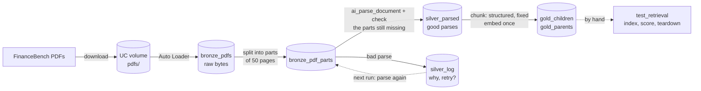
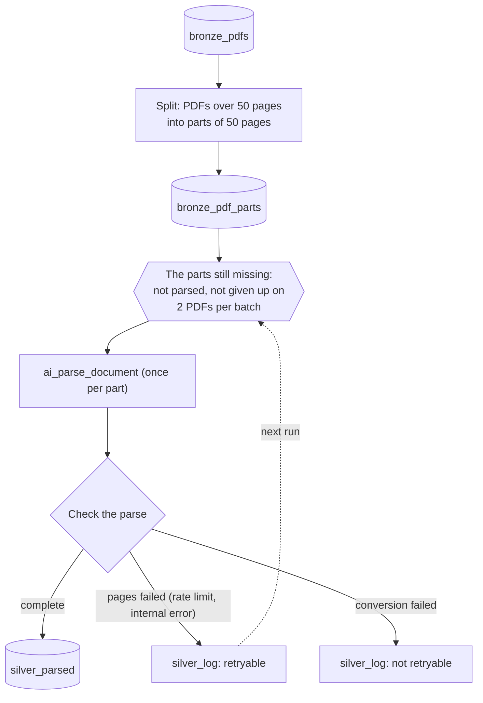

# dbx-finance-bench-rag

A RAG pipeline on Databricks over the [FinanceBench](https://github.com/patronus-ai/financebench) filings: 368 SEC filings (10-Ks, 10-Qs, 8-Ks), most of them 100 to 300 pages long. This repository covers the **ingestion** (getting the PDFs into Delta tables and parsing them), the **gold layer** (chunks and their embeddings) and a **retrieval test** that scores the retrievers on FinanceBench's questions.

Everything is a Databricks Asset Bundle. Pushing a branch deploys it to `dev`, and merging to `master` deploys it to `prod` (see [doc/setup.md](doc/setup.md#4-cicd-with-github-actions)).

## At a glance



| Layer | Task | Output | Status |
| --- | --- | --- | --- |
| Download | `download` | PDFs in a Unity Catalog volume | Done |
| Bronze | `bronze_pdfs`, `bronze_split` | Tables `bronze_pdfs` (raw PDF bytes) and `bronze_pdf_parts` (the PDFs cut into parts of up to 50 pages) | Done |
| Silver | `silver_parse` | Tables `silver_parsed` (the parser's **elements**: headings, text, tables as HTML, each with its page) and `silver_log`, and the view `silver_failures` | Built and tested in dev. Prod data: 366 of 368 PDFs fully parsed (see [results](#results)) |
| Validation | `validate_silver` (separate job) | A pass or fail check of the tables, and what is still open | Done |
| Gold | `chunk_structured`, `chunk_fixed`, `embed` (job `indexing`) | Tables `gold_children` (searched, with the embeddings) and `gold_parents` (what the LLM reads) | Built and unit-tested, not run on Databricks yet (see [gold.md](doc/medallion/gold/gold.md)) |
| Retrieval test | `test_retrieval` (separate job, one notebook, run by hand) | Scores in `test_retrieval_results`. Creates the Vector Search index and deletes it again | Built, not run on Databricks yet (see [test_retrieval.md](doc/retrieval/test_retrieval.md)) |

The tasks run in this order in the job `ingest_financebench`: `download`, `bronze_pdfs`, `bronze_split`, `silver_parse`. The job `financebench_pipeline` runs ingestion, validation, then `indexing`.

Gold reads the parser's elements in `silver_parsed`. Silver used to convert every page to Markdown with a model (`ai_query`); that step was removed, see [why](#why-there-is-no-markdown-step).

Every task is **safe to rerun**: each one remembers what it has already done and only processes what is new.

## Repository layout

```
databricks.yml              bundle: variables and the dev and prod targets
resources/
  ingest_job.yml            job ingest_financebench: download, bronze_pdfs, bronze_split, silver_parse
  financebench_pipeline_job.yml  job financebench_pipeline: ingestion, then validation
  validate_job.yml          job validate_silver: a separate pipeline that checks the tables
src/
  common/                   names.py (table and path names of both layers, the insert helper)
  bronze/                   BRONZE: download.py, bronze_pdfs.ipynb, split_pdfs.ipynb
                            splitting.py (cut a PDF into parts), bronze_tables.py (the parts table)
  silver/                   SILVER: parse_pdfs.ipynb
                            checks.py (checks on parser output, plain Python)
                            silver_tables.py (tables and views), parsing.py (parse and file a part)
  validate/                 validate_silver.ipynb
  gold/                     GOLD: chunk_documents.ipynb, embed_chunks.ipynb
                            elements.py, tables.py, sections.py, text_split.py, chunking.py, gold_tables.py
  retrieval/                test_retrieval.ipynb (one notebook: index, retrievers, scores, teardown)
tests/                      test_checks.py, test_gold.py (pytest, no Databricks needed)
doc/                        setup, one page per layer
.github/workflows/          deploy-dev, deploy-prod, test
```

## Environments: dev and prod share the schemas

Each layer has one schema, and dev and prod use the **same** ones, so there is one set of tables instead of a copy per target. Dev downloads only 28 short PDFs, so a dev run is cheap.

| | dev (every push to a branch) | prod (merge to `master`) |
| --- | --- | --- |
| Bronze schema | `workspace.finance_bench_bronze` | `workspace.finance_bench_bronze` |
| Silver schema | `workspace.finance_bench_silver` | `workspace.finance_bench_silver` |
| Gold schema | `workspace.finance_bench_gold` | `workspace.finance_bench_gold` |
| Vector Search endpoint (test_retrieval) | `financebench_vs_dev` | `financebench_vs` |
| PDFs | 28 earnings releases (`pdf_match`, `pdf_limit`) | all 368 |

The values are bundle variables in [databricks.yml](databricks.yml). Job names and notebooks are still separate per target (dev jobs are prefixed with `[dev <user>]`).

**What sharing means.** A dev run is a real run: it writes to the real tables. Pushing a branch only deploys, and nothing runs until someone runs a job. So:

- Do not run the same job in dev and in prod at the same time. They would parse the same parts twice, and parsing is billed.
- A branch that changes the chunking or the parsing, once run, leaves its rows next to the old ones. Delete them first, as described in [gold.md](doc/medallion/gold/gold.md#operations).
- Dev still downloads only 28 PDFs (`pdf_match`, `pdf_limit`), and uses the same `part_pages` as prod.

## 1. Download

Downloads all FinanceBench PDFs into the volume `/Volumes/<catalog>/<bronze_schema>/docs/pdfs/`. Files already in the volume are skipped.

Details: [doc/download/download.md](doc/download/download.md)

## 2. Bronze: raw PDFs

Loads the PDFs, as is, into the Delta table `bronze_pdfs` (`path`, `modificationTime`, `length`, `content`) with Auto Loader. A checkpoint means each run loads only new files. The first run loaded all 368 PDFs.

Details: [doc/medallion/bronze/bronze.md](doc/medallion/bronze/bronze.md)

## 3. Silver: PDFs to parsed elements

Parses each filing with `ai_parse_document` into **typed elements** (title, section header, text, table as HTML, page header, ...), each with its page, and checks every parse. Gold chunks these elements directly. The code is in [src/silver/](src/silver/): one notebook (`parse_pdfs`, with an explanation of the stage, able to run on its own) and three short Python modules. The checks on parser output are in [src/silver/checks.py](src/silver/checks.py), and they are unit-tested.

The design follows three rules:

1. **Check every result, and keep the bad ones apart.** A parse that is incomplete never goes into the good table. It goes to `silver_log`, with the reason and whether a retry makes sense.
2. **Every stage can run again.** Each stage works out what is still missing and does only that. A rerun, a retry and a recovery after a crash are the same code, and nothing already stored is paid for twice.
3. **Small steps, no budgets.** Each run does everything that is missing, and a part whose parse failed is parsed again by the next run: there is no separate retry task. Parsing is paced (two PDFs at a time, a pause between batches, a stop when the service keeps failing), so a failed run loses little and the next run continues.

### Tables

| Table / view | Holds |
| --- | --- |
| `silver_parsed` | One row per part whose parse is complete: the parsed elements (VARIANT) and page counts |
| `silver_log` | The trail: every failed parse, with the reason, the attempt number and whether a retry makes sense. Nothing is ever deleted from it |
| `silver_failures` (view) | What is still open: the parts not parsed |

### How it works



1. **Split (bronze).** Every PDF with more than 50 pages is cut into parts of at most 50 pages ([splitting.py](src/bronze/splitting.py)), and the bytes of each part go to `bronze_pdf_parts` with the part's `page_offset`. Cutting does not change the content, so the parts are still raw bytes and belong in bronze. Silver only ever sees parts. The real page number of an element is `page_offset + page_id + 1`.
2. **Parse what is missing.** A part is missing when it is not in `silver_parsed` and has not been given up on. `ai_parse_document` runs once per missing part, two PDFs at a time. `check_parse` is a short Python function: a parse is good if it has elements and no page errors. A good parse goes to `silver_parsed`. A bad one goes to `silver_log`, marked retryable (temporary page errors) or not (a failed conversion).
3. **Retry = the next run.** A part that failed is still missing, so the next run parses it again with the same function. It is not tried again in the same run, so a busy service is not hit straight away. A retry costs at most one part, which is 50 parse pages. A failure that is not retryable is never tried again, and after `max_attempts` a part is left alone. Both stay visible in `silver_failures`. Two batches in a row that store nothing stop the run.

**No stream, no checkpoint.** An earlier version read `bronze_pdf_parts` as a stream. A stream sees each row once, so a failed part could not come back and needed its own retry task. The tables now say what is missing, so a rerun, a retry and a recovery after a crash are the same code, and a restart costs almost nothing: parts already in `silver_parsed` are never parsed (billed) again.

### Example

`ai_parse_document` returns typed elements. For the first page of the Boeing 2022 10-K:

| type | page | content |
| --- | --- | --- |
| figure | 0 | BOEING |
| text | 0 | UNITED STATES SECURITIES AND EXCHANGE COMMISSION Washington, D.C. 20549 |
| title | 0 | FORM 10-K |
| text | 0 | (Mark One) |

A table comes as HTML in one `table` element. Gold turns it into rows in plain code, so the numbers stay exactly as parsed.

### Why there is no Markdown step

An earlier version converted every parsed page to Markdown with `ai_query` (one call per page, 53,714 calls) and put the pages together in a view `silver_documents`. It was removed:

- **It was not faithful.** Compared with the parser's elements on 2,160 sampled pages, 14% had different numbers. Examples: a table row where `3.24%` became `3.23%` and two cells were dropped, and a debt table that moved to the neighbouring page, leaving the real page without it. Nothing flags these, and the validation could not catch them.
- **It added nothing the code cannot do.** The parser already says what is a heading and what is a table, with its page. Turning that into rows or text is a few lines of Python.
- **It cost the most.** One paid model call per page, and a model between the filing and the numbers.

Checked against the PDFs' own text, the parser is accurate: on 12 evidence pages all 818 numbers matched in both directions, and 97% of 939 sampled table rows had the right numbers in the right order. About 96% of the `Item N` headings come out as headings (some wrapped in HTML tags like `<u>Item 1. Business</u>`, a few typed as `text`, which gold handles). That is a sample of 12 filings, not a full audit.

### Challenges and solutions

| # | Challenge | Solution |
| --- | --- | --- |
| 1 | `ai_parse_document` answered some pages with `Request rate limit exceeded` or `Internal error` (3,180 of 49,965 pages, in 55 PDFs), because 10 PDFs were parsed at once. Those pages had no content | Cut long PDFs into parts of 50 pages (a test PDF that lost 27 pages whole parsed completely in 4 parts). Check every parse. Never store an incomplete one: log it as retryable and parse it again later. Parse 2 files at a time |
| 2 | A failure late in a long run must not lose finished work, and a rerun must not pay for it again | Every stage only does what is missing, so a restart costs almost nothing: a part already in `silver_parsed` is never parsed again |
| 3 | A part that can never succeed would retry forever | The attempt number is in the log. After `max_attempts` it is left alone and listed in `silver_failures` |
| 4 | `ai_parse_document` rejects PDFs over 500 pages (8 filings) and sometimes fails a conversion (1) | The split makes the large PDFs parseable. A failed conversion is logged as not retryable |
| 5 | A limited quota (the free tier) | Small batches, a pause between batches, a stop when the service keeps failing, and an attempt cap per part |

### Look at the open problems

```sql
SELECT * FROM silver_failures ORDER BY path, part_no;              -- what is still open, and why
SELECT * FROM silver_log WHERE path LIKE '%PEPSICO_2018%';         -- the history of one PDF
```

### Results

State of the real data in prod (`finance_bench_bronze`, `finance_bench_silver`):

| | |
| --- | --- |
| PDFs in `bronze_pdfs` | 368 |
| Parts in `bronze_pdf_parts` (PDFs cut into parts of up to 50 pages) | 637 |
| Parts parsed | 635 |
| PDFs fully parsed (all their parts in `silver_parsed`) | **366 of 368** |
| Not parseable | 2: `INTEL_2023_8K_dated-2023-02-10.pdf` and `INTEL_2023_8K_dated-2023-08-16.pdf` fail with "Document conversion failed" in the parser |

Before the split, 304 PDFs parsed, 55 lost pages to the parser's rate limit and 9 could not be parsed (7 over 500 pages). In parts, those 55 and the PDFs over 500 pages parse, and a 155-page filing that lost 27 pages whole parsed completely.

**What is validated.** The `validate_silver` job checks that the tables are consistent: every PDF has parts, and every part is parsed or logged. It does **not** check that the elements are right. That was checked once, against the PDFs, on a sample (see above).

**Tested in dev** (before dev and prod shared the schemas: own schemas, 28 short earnings releases, cut into parts of 5 pages): 102 of 103 parts parsed, and the validation job passed.

### Limits and next steps

- **Cost:** `ai_parse_document` is billed per page. A part that parses completely is never parsed again, and a retry (the next run) costs at most 50 parse pages.
- **Two PDFs have no parse:** the INTEL 8-Ks that fail with `Document conversion failed` in the parser. The split made the 8 PDFs over 500 pages parseable.
- **Changed or deleted PDFs:** not handled. Bronze tracks files by path, and silver keeps rows of deleted files. See [happy_unhappy_path.md](doc/medallion/silver/happy_unhappy_path.md).
- **Parser accuracy** was checked on a sample against the PDFs, not on all of them.
- **Next:** gold chunks `silver_parsed` and embeds the chunks (job `indexing`), and `test_retrieval` scores the retrievers. See [doc/indexing/indexing.md](doc/indexing/indexing.md).

## Run it

```bash
databricks bundle deploy -t dev                       # CI does this on every push
databricks bundle run ingest_financebench -t dev      # download, bronze (load, split), silver (parse)
databricks bundle run validate_silver -t dev          # check the tables (a separate pipeline)
databricks bundle run indexing -t dev                 # gold: chunk (both strategies), embed what has no vector
databricks bundle run test_retrieval -t dev           # by hand: index, FinanceBench scores, teardown (the endpoint is billed hourly)
python -m pytest                                      # unit tests, no Databricks needed
```

Silver parameters (notebook widgets, set by the bundle variables):

| Widget | Task | Default | Meaning |
| --- | --- | --- | --- |
| `catalog`, `bronze_schema`, `silver_schema` | all | `workspace`, per layer and target | From the bundle variables |
| `part_pages` | `bronze_split` | `50` | PDFs with more pages are cut into parts of this size |
| `pdfs_per_batch` | `silver_parse` | `2` | PDFs parsed at once (all their missing parts) |
| `max_attempts` | `silver_parse` | `3` | A part is given up on after this many failed parses |
| `batch_pause_seconds` | `silver_parse` | `5` | Pause between batches |

To look before you spend, query `silver_failures` (see [silver.md](doc/medallion/silver/silver.md)).

- **Rerun or redeploy:** safe. Only the parts that are missing are parsed: new ones, and failures that are retryable and have attempts left.
- **Silver rebuild:** drop the silver tables (or the schema) and run. This parses everything again, which spends quota. Bronze is not touched.
- **Bronze rebuild:** drop the bronze schema and run. The PDFs are downloaded again (free), and the parts are cut again. Deleting only the tables leaves the checkpoint, so nothing would be reparsed.

## More documentation

| Doc | Contents |
| --- | --- |
| [doc/setup.md](doc/setup.md) | CLI install, authentication, deploying the bundle, CI/CD, GitHub secrets, Unity Catalog grants |
| [doc/download/download.md](doc/download/download.md) | How the PDF download works |
| [doc/medallion/bronze/bronze.md](doc/medallion/bronze/bronze.md) | The bronze table and the Auto Loader load |
| [doc/medallion/silver/silver.md](doc/medallion/silver/silver.md) | Silver operations: where to look, what to do when something is open |
| [doc/medallion/silver/happy_unhappy_path.md](doc/medallion/silver/happy_unhappy_path.md) | Edge cases and open decisions for silver |
| [doc/medallion/gold/gold.md](doc/medallion/gold/gold.md) | The gold layer: chunking strategies, tables, embeddings, operations |
| [doc/retrieval/test_retrieval.md](doc/retrieval/test_retrieval.md) | The retrieval test notebook: index lifecycle, LangChain retrievers, scores |
| [doc/indexing/indexing.md](doc/indexing/indexing.md) | Where indexing and retrieval fit, the decisions, what is open |
| [src/silver/](src/silver/) | The silver notebooks and modules, with an explanation cell for every stage |
| [src/validate/validate_silver.ipynb](src/validate/validate_silver.ipynb) | The separate validation pipeline: integrity checks on the tables, and what is still open |
| [tests/](tests/) | Unit tests: silver checks and the gold chunker |
