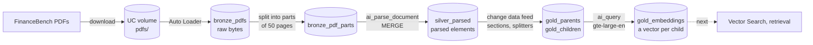

# dbx-finance-bench-rag

A RAG pipeline on Databricks over the [FinanceBench](https://github.com/patronus-ai/financebench) filings: 368 SEC filings (10-Ks, 10-Qs, 8-Ks), most of them 100 to 300 pages long. The repository is being **rebuilt from the bottom up**. What exists today is the ingestion (getting the PDFs into Delta tables and cutting them into parts) the silver step, parsing the parts with the AI parser (it repairs itself on a rerun), and the gold steps, parent-child chunks and their embeddings. Retrieval comes next, one layer at a time.

Everything is a Databricks Asset Bundle. Pushing a branch deploys it to `dev`, and merging to `master` deploys it to `prod` (see [doc/setup.md](doc/setup.md#4-cicd-with-github-actions)).

## At a glance



| Layer | Task | Output | Status |
| --- | --- | --- | --- |
| Download | `download` | PDFs in a Unity Catalog volume | Done |
| Bronze | `bronze_pdfs`, `bronze_split` | Tables `bronze_pdfs` (raw PDF bytes) and `bronze_pdf_parts` (the PDFs cut into parts of up to 50 pages) | Done |
| Silver | `silver_parse` | Table `silver_parsed`: the parser's elements (headings, text, tables as HTML, each with its page) for every part, repaired on a rerun when the parser's rate limit lost pages | Run in prod: 368 documents, 637 parts |
| Gold | `gold_chunk`, `gold_embed` | Tables `gold_parents` (one per section), `gold_children` (pieces of about 2,000 characters, and tables, cut into groups of rows when large) and `gold_embeddings` (each child with its vector) | Run in prod: 366 documents (2 could not be parsed), 193,635 children, all embedded |
| Retrieval | | Search over the chunks, and a score on FinanceBench's questions | Not started |

The tasks run in this order in the job `ingest_financebench`: `download`, `bronze_pdfs`, `bronze_split`, `silver_parse`, `gold_chunk`, `gold_embed`.

Every task is **safe to rerun**: each one remembers what it has already done and only processes what is new.

## Repository layout

```
databricks.yml              bundle: variables and the dev and prod targets
resources/
  ingest_job.yml            job ingest_financebench: download, bronze_pdfs, bronze_split, silver_parse, gold_chunk, gold_embed
src/
  bronze/                   BRONZE: download.py, bronze_pdfs.ipynb, split_pdfs.ipynb
                            splitting.py (cut a PDF into parts)
  silver/                   SILVER: parse_pdfs.ipynb (the AI parser on every part, one notebook)
  gold/                     GOLD: chunk.ipynb (parent-child chunks with LangChain)
                            embed.ipynb (a vector per child, with ai_query)
tests/                      test_splitting.py (pytest, no Databricks needed)
doc/                        setup, one page per step
.github/workflows/          deploy-dev, deploy-prod, test
```

## Environments: dev and prod share the schemas

Dev and prod use the **same** schemas, so there is one set of tables instead of a copy per target. Dev downloads only 28 short PDFs, so a dev run is cheap.

| | dev (every push to a branch) | prod (merge to `master`) |
| --- | --- | --- |
| Bronze schema | `workspace.finance_bench_bronze` | `workspace.finance_bench_bronze` |
| Silver schema | `workspace.finance_bench_silver` | `workspace.finance_bench_silver` |
| Gold schema | `workspace.finance_bench_gold` | `workspace.finance_bench_gold` |
| PDFs | 28 earnings releases (`pdf_match`, `pdf_limit`) | all 368 |

The schemas are constants in the notebooks, and the dev sample is the bundle variables `pdf_match` and `pdf_limit` in [databricks.yml](databricks.yml). Job names and notebooks are still separate per target (dev jobs are prefixed with `[dev <user>]`).

**What sharing means.** A dev run is a real run: it writes to the real tables. Pushing a branch only deploys, and nothing runs until someone runs a job. So do not run the same job in dev and in prod at the same time: they would parse the same parts twice, and parsing is billed.

## 1. Download

Downloads all FinanceBench PDFs into the volume `/Volumes/workspace/finance_bench_bronze/docs/pdfs/`. Files already in the volume are skipped.

Details: [doc/download/download.md](doc/download/download.md)

## 2. Bronze: raw PDFs

Loads the PDFs, as is, into the Delta table `bronze_pdfs` (`path`, `modificationTime`, `length`, `content`) with Auto Loader. A checkpoint means each run loads only new files. The first run loaded all 368 PDFs. Then every PDF with more than 50 pages is cut into parts of at most 50 pages and stored in `bronze_pdf_parts`, so a part that fails to parse later can be retried alone.

Details: [doc/medallion/bronze/bronze.md](doc/medallion/bronze/bronze.md)

## 3. Silver: the AI parser

Runs `ai_parse_document` on the parts of `bronze_pdf_parts` and saves the parser's output in `silver_parsed`, one row per part, with the document name (`doc_name`, such as `3M_2018_10K`, from the file name). **It repairs itself on a rerun.** The parser does not fail when it cannot convert a page: it leaves the page out and says why in `error_status`. A page lost to the parser's rate limit converts on a second try, so every run parses the parts that are new and the parts whose stored parse lost a page to the rate limit, and writes them with a `MERGE` on `path` and `part_no` (insert a new part, replace a repaired one). The results go to a staging table first, so the parser runs once per part. A part parsed cleanly is never parsed again, and a file the parser cannot convert at all ("Document conversion failed.", such as two of Intel's 8-Ks) is stored with its error and not retried. Change data feed is on, so gold sees the replaced parts. The notebook creates the schema and the table if they do not exist (the catalog must already exist). Its names and settings are constants hardcoded in the notebook's second cell, not job parameters. The notebook is [src/silver/parse_pdfs.ipynb](src/silver/parse_pdfs.ipynb), and it explains each step.

## 4. Gold: parent-child chunks

Cuts the parsed elements into **parents** and **children**. A parent is a section: a new one starts at every title or section header, and it holds the section's text, tables and figure descriptions (page headers, footers and page numbers are dropped). It is what the LLM reads. The children are what is embedded and searched: the section's text cut by LangChain's `RecursiveCharacterTextSplitter` (about 2,000 characters, 200 overlap) in a pandas UDF, plus the tables. A table of up to 4,000 characters (`TABLE_CHUNK_SIZE`) is one child; a bigger one is cut between rows into groups, each repeating the table's header rows, by a small BeautifulSoup UDF (LangChain's HTML splitters either keep a table whole or cut it in the middle of a row). Each child starts with its document and section header and keeps its `parent_id` and pages. It is a stream on silver's change data feed: a run takes the parts that silver inserted or replaced since the last run, chunks their documents again from all their parts (a section can cross parts) and replaces only those documents' rows in `gold_parents` and `gold_children`. The notebook is [src/gold/chunk.ipynb](src/gold/chunk.ipynb).

## 5. Gold: embeddings

Gives every child a vector with `ai_query` on `databricks-gte-large-en` (1,024 numbers) and saves it in `gold_embeddings`: the child's columns and its `embedding`. A table child is embedded without its HTML tags, and the text sent to the model is cut at `MAX_EMBED_CHARS` (16,000) characters; the stored `text` is the child as it is. The vectors are not kept in `gold_children`, because `gold_chunk` replaces a document's children whenever a new part arrives: in their own table, a child is embedded once and again only when its text changes. A run first deletes the vectors whose child is gone or changed (a `MERGE` on `child_id` and `text`), then embeds the children with no vector, 20 documents (`DOCS_PER_BATCH`) per save point. Change data feed is on, so a Vector Search Delta Sync index with self-managed embeddings can sync from it. The notebook is [src/gold/embed.ipynb](src/gold/embed.ipynb).

## Run it

```bash
databricks bundle deploy -t dev                       # CI does this on every push
databricks bundle run ingest_financebench -t dev      # download, bronze (load, split), silver (parse), gold (chunk, embed)
python -m pytest                                      # unit tests, no Databricks needed
```

Every name and setting (`CATALOG`, the schemas, `PART_PAGES`, `PDFS_PER_BATCH`, `CHUNK_SIZE`, ...) is a constant hardcoded at the top of its notebook or script ([doc/code_standard.md](doc/code_standard.md)). To change one, change it there. The only parameters are the dev sample, because dev and prod need different values:

| Bundle variable | Task | Default | Meaning |
| --- | --- | --- | --- |
| `pdf_match`, `pdf_limit` | `download` | `.*`, `0` (dev: `EARNINGS`, `28`) | Download only the PDFs whose name matches, and only the first n (0 = all) |

Failures are not handled: a download, a PDF that cannot be cut or a parse that raises an error makes its task fail. Fix the cause and rerun. The one exception is the parser's rate limit: it does not raise an error, it leaves pages out, and silver parses those parts again on the next run.

- **Rerun or redeploy:** safe. Files already downloaded, loaded, cut or parsed are skipped, and parts that lost pages to the parser's rate limit are parsed again.
- **Gold rebuild:** drop `gold_parents`, `gold_children` and the volume `checkpoints` in the gold schema, and run. Nothing is parsed again, and a child whose text is the same keeps its vector in `gold_embeddings`.
- **Re-chunk after a change to the chunking** (with the same columns): delete only the folder `checkpoints/chunk_cdf` in the gold schema's volume, and run. `gold_chunk` reads all of `silver_parsed` again and replaces every document's rows; `gold_embed` deletes the vectors of children that changed and embeds the new ones. If the columns change, drop `gold_parents` and `gold_children` too.
- **Embed again** (another model, say): drop `gold_embeddings` and run. Every child is embedded again, which is billed.
- **Silver rebuild:** drop `silver_parsed` and run, then delete the gold folder `checkpoints/chunk_cdf` so gold starts on the new table. This parses every part again, which is billed per page. Bronze is not touched.
- **Bronze rebuild:** drop the bronze schema and run. The PDFs are downloaded again (free), and the parts are cut again. Deleting only the tables leaves the Auto Loader checkpoint, so nothing would be reloaded.

## More documentation

| Doc | Contents |
| --- | --- |
| [doc/code_standard.md](doc/code_standard.md) | How code is written here: notebook cell order, constants, no failure handling |
| [doc/setup.md](doc/setup.md) | CLI install, authentication, deploying the bundle, CI/CD, GitHub secrets, Unity Catalog grants |
| [doc/download/download.md](doc/download/download.md) | How the PDF download works |
| [doc/medallion/bronze/bronze.md](doc/medallion/bronze/bronze.md) | The bronze tables, the Auto Loader load and the split |
| [tests/](tests/) | Unit tests: cutting a PDF into parts |
