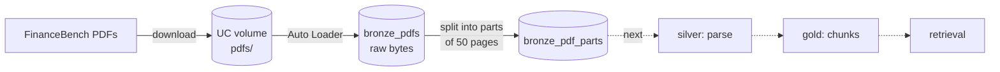

# dbx-finance-bench-rag

A RAG pipeline on Databricks over the [FinanceBench](https://github.com/patronus-ai/financebench) filings: 368 SEC filings (10-Ks, 10-Qs, 8-Ks), most of them 100 to 300 pages long. The repository is being **rebuilt from the bottom up**. What exists today is the ingestion: getting the PDFs into Delta tables and cutting them into parts. Parsing, chunking and retrieval come next, one layer at a time.

Everything is a Databricks Asset Bundle. Pushing a branch deploys it to `dev`, and merging to `master` deploys it to `prod` (see [doc/setup.md](doc/setup.md#4-cicd-with-github-actions)).

## At a glance



| Layer | Task | Output | Status |
| --- | --- | --- | --- |
| Download | `download` | PDFs in a Unity Catalog volume | Done |
| Bronze | `bronze_pdfs`, `bronze_split` | Tables `bronze_pdfs` (raw PDF bytes) and `bronze_pdf_parts` (the PDFs cut into parts of up to 50 pages) | Done |
| Silver | | The parser's output for every part | Not started |
| Gold | | Chunks and embeddings | Not started |
| Retrieval | | Search over the chunks, and a score on FinanceBench's questions | Not started |

The tasks run in this order in the job `ingest_financebench`: `download`, `bronze_pdfs`, `bronze_split`.

Every task is **safe to rerun**: each one remembers what it has already done and only processes what is new.

## Repository layout

```
databricks.yml              bundle: variables and the dev and prod targets
resources/
  ingest_job.yml            job ingest_financebench: download, bronze_pdfs, bronze_split
src/
  bronze/                   BRONZE: download.py, bronze_pdfs.ipynb, split_pdfs.ipynb
                            splitting.py (cut a PDF into parts), bronze_tables.py (the parts table)
tests/                      test_splitting.py (pytest, no Databricks needed)
doc/                        setup, one page per step
.github/workflows/          deploy-dev, deploy-prod, test
```

## Environments: dev and prod share the schema

Dev and prod use the **same** schema, so there is one set of tables instead of a copy per target. Dev downloads only 28 short PDFs, so a dev run is cheap.

| | dev (every push to a branch) | prod (merge to `master`) |
| --- | --- | --- |
| Bronze schema | `workspace.finance_bench_bronze` | `workspace.finance_bench_bronze` |
| PDFs | 28 earnings releases (`pdf_match`, `pdf_limit`) | all 368 |

The values are bundle variables in [databricks.yml](databricks.yml). Job names and notebooks are still separate per target (dev jobs are prefixed with `[dev <user>]`).

**What sharing means.** A dev run is a real run: it writes to the real tables. Pushing a branch only deploys, and nothing runs until someone runs a job. So do not run the same job in dev and in prod at the same time.

## 1. Download

Downloads all FinanceBench PDFs into the volume `/Volumes/<catalog>/<bronze_schema>/docs/pdfs/`. Files already in the volume are skipped.

Details: [doc/download/download.md](doc/download/download.md)

## 2. Bronze: raw PDFs

Loads the PDFs, as is, into the Delta table `bronze_pdfs` (`path`, `modificationTime`, `length`, `content`) with Auto Loader. A checkpoint means each run loads only new files. The first run loaded all 368 PDFs. Then every PDF with more than 50 pages is cut into parts of at most 50 pages and stored in `bronze_pdf_parts`, so a part that fails to parse later can be retried alone.

Details: [doc/medallion/bronze/bronze.md](doc/medallion/bronze/bronze.md)

## Run it

```bash
databricks bundle deploy -t dev                       # CI does this on every push
databricks bundle run ingest_financebench -t dev      # download, bronze (load, split)
python -m pytest                                      # unit tests, no Databricks needed
```

Parameters (notebook widgets, set by the bundle variables):

| Widget | Task | Default | Meaning |
| --- | --- | --- | --- |
| `catalog`, `bronze_schema` | all | `workspace`, `finance_bench_bronze` | From the bundle variables |
| `pdf_match`, `pdf_limit` | `download` | `.*`, `0` (dev: `EARNINGS`, `28`) | Download only the PDFs whose name matches, and only the first n (0 = all) |
| `part_pages` | `bronze_split` | `50` | PDFs with more pages are cut into parts of this size |

- **Rerun or redeploy:** safe. Files already downloaded, loaded or cut are skipped.
- **Bronze rebuild:** drop the bronze schema and run. The PDFs are downloaded again (free), and the parts are cut again. Deleting only the tables leaves the Auto Loader checkpoint, so nothing would be reloaded.

## More documentation

| Doc | Contents |
| --- | --- |
| [doc/setup.md](doc/setup.md) | CLI install, authentication, deploying the bundle, CI/CD, GitHub secrets, Unity Catalog grants |
| [doc/download/download.md](doc/download/download.md) | How the PDF download works |
| [doc/medallion/bronze/bronze.md](doc/medallion/bronze/bronze.md) | The bronze tables, the Auto Loader load and the split |
| [tests/](tests/) | Unit tests: cutting a PDF into parts |
