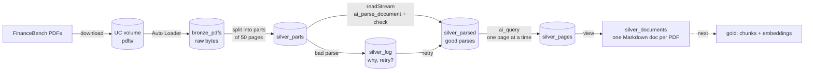
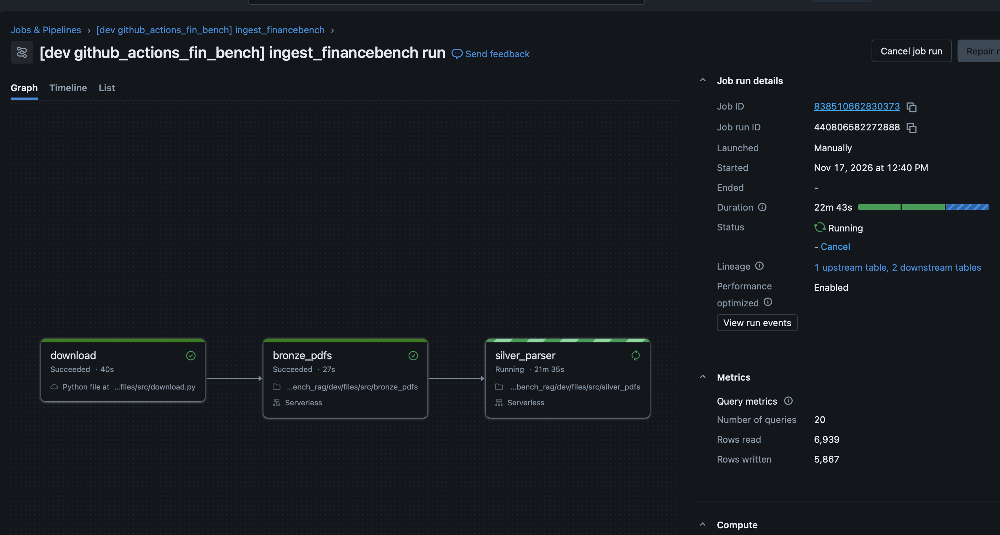
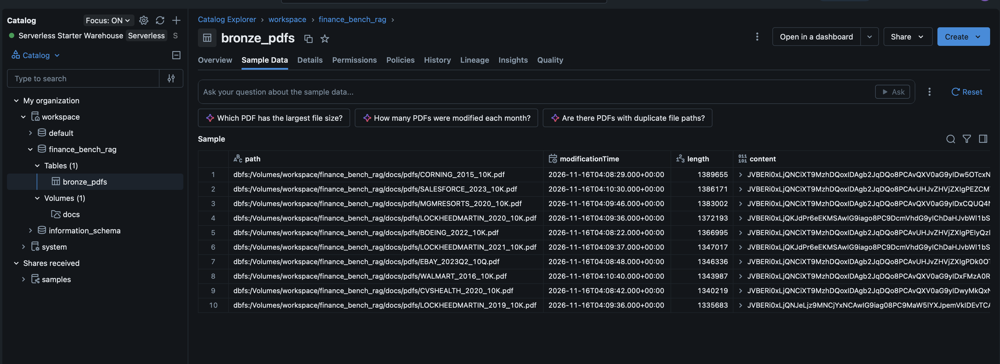
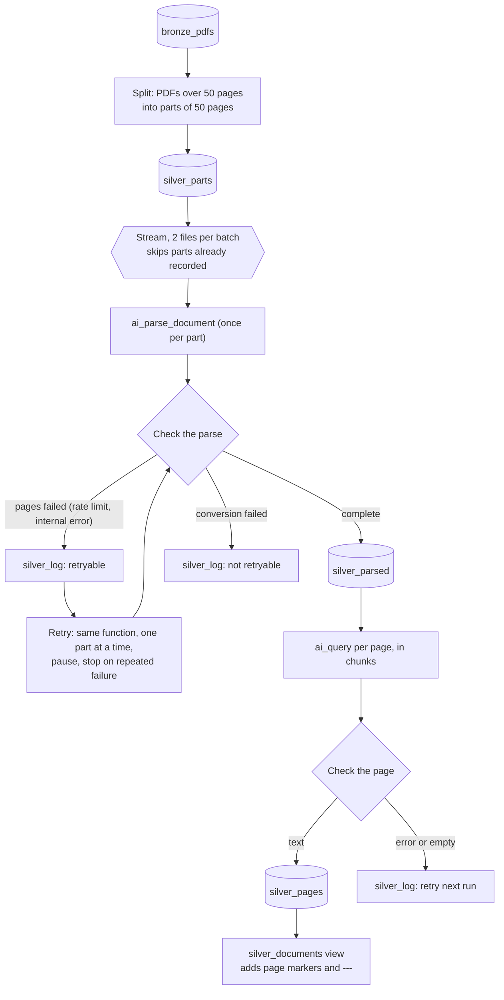

# dbx-finance-bench-rag

A RAG pipeline on Databricks over the [FinanceBench](https://github.com/patronus-ai/financebench) filings: 368 SEC filings (10-Ks, 10-Qs, 8-Ks), most of them 100 to 300 pages long. This repository covers the **ingestion**: getting the PDFs into Delta tables and turning them into clean Markdown text, ready for chunking and retrieval.

Everything is a Databricks Asset Bundle. Pushing a branch deploys it to `dev`, and merging to `master` deploys it to `prod` (see [doc/setup.md](doc/setup.md#4-cicd-with-github-actions)).

## At a glance



| Layer | Task | Output | Status |
| --- | --- | --- | --- |
| Download | `download` | PDFs in a Unity Catalog volume | Done |
| Bronze | `bronze_pdfs` | Table `bronze_pdfs`: raw PDF bytes | Done |
| Silver | `silver_split`, `silver_parse`, `silver_retry`, `silver_convert` | Tables `silver_parts`, `silver_parsed`, `silver_pages`, `silver_log` and the view `silver_documents`: **Markdown** per PDF | Built and tested in dev. Prod data: 291 of 368 documents complete, the rest waiting (see [results](#results)) |
| Validation | `validate_silver` (separate job) | A pass or fail check of the tables, and what is still open | Done |
| Gold | not started | Chunks and embeddings | Next |

The tasks run in order in the job `ingest_financebench` (the screenshot is from the first design, which had one silver task):



Every task is **safe to rerun**: each one remembers what it has already done and only processes what is new.

## Repository layout

```
databricks.yml              bundle: variables and the dev and prod targets
resources/
  ingest_job.yml            job ingest_financebench: download, bronze, silver_parse, silver_retry, silver_convert
  validate_job.yml          job validate_silver: a separate pipeline that checks the tables
src/
  ingest/                   download.py, bronze_pdfs.ipynb
  silver/                   parse_pdfs.ipynb, retry_parses.ipynb, convert_pages.ipynb
                            checks.py (checks on parser and model output, plain Python)
                            tables.py (table names and definitions), parsing.py (parse and file a PDF)
  validate/                 validate_silver.ipynb
  tools/                    inspect_parsed.ipynb (look at one parsed document)
tests/                      test_checks.py (pytest, no Databricks needed)
doc/                        setup, one page per layer
.github/workflows/          deploy-dev, deploy-prod, test
```

## Environments: testing never touches prod

The dev and prod targets use **different schemas**, so tables, the volume and the stream checkpoints are separate. Dev also downloads only five short PDFs  so a test run is cheap.

| | dev (every push to a branch) | prod (merge to `master`) |
| --- | --- | --- |
| Schema | `workspace.finance_bench_rag_dev` | `workspace.finance_bench_rag` |
| PDFs | 15 earnings releases (`pdf_match`, `pdf_limit`) | all 368 |

The values are bundle variables in [databricks.yml](databricks.yml). The validation job can also check the prod data from dev without writing to it: run it with the `schema` parameter set to `finance_bench_rag`. It only reads.

## 1. Download

Downloads all FinanceBench PDFs into the volume `/Volumes/<catalog>/<schema>/docs/pdfs/`. Files already in the volume are skipped.


Details: [doc/download/download.md](doc/download/download.md)

## 2. Bronze: raw PDFs

Loads the PDFs, as is, into the Delta table `bronze_pdfs` (`path`, `modificationTime`, `length`, `content`) with Auto Loader. A checkpoint means each run loads only new files. The first run loaded all 368 PDFs.



Details: [doc/medallion/bronze/bronze.md](doc/medallion/bronze/bronze.md)

## 3. Silver: PDFs to Markdown

Turns each filing into **one Markdown document** that keeps its structure: titles, headings, plain text, tables, page headers and footers, and page separators. The code is in [src/silver/](src/silver/): three small notebooks (`parse_pdfs`, `retry_parses`, `convert_pages`, each with an explanation of its stage and able to run on its own) and three short Python modules. The checks on parser and model output are in [src/silver/checks.py](src/silver/checks.py), and they are unit-tested.

The design follows four rules:

1. **Check every result, and keep the bad ones apart.** A parse that is incomplete, or a page that did not convert, never goes into the good tables. It goes to `silver_log`, with the reason and whether a retry makes sense.
2. **Every stage can run again.** Each stage works out what is still missing and does only that. A rerun, a retry and a recovery after a crash are the same code, and nothing already stored is paid for twice.
3. **The code, not the model, owns the document structure.** The model only converts the text of one page. The page markers and the `---` between pages are added by a view.
4. **Small steps, no budgets.** Each run does everything that is missing. Retries are paced (a pause between PDFs, a stop when the service keeps failing) and pages are saved in chunks, so a failed run loses little and the next run continues.

### Tables

| Table / view | Holds |
| --- | --- |
| `silver_parts` | The PDFs cut into parts of at most 50 pages: the bytes of each part, its `part_no` and `page_offset` |
| `silver_parsed` | One row per part whose parse is complete: the parsed elements (VARIANT) and page counts |
| `silver_pages` | The Markdown of each converted page, by real PDF page number |
| `silver_log` | The trail: every failed parse and every failed page, with the reason, the attempt number and whether a retry makes sense |
| `silver_documents` (view) | The final Markdown per PDF, only for PDFs whose pages are all converted |
| `silver_failures` (view) | What is still open: parts not parsed and pages not converted |

### How it works



1. **Split.** Every PDF with more than 50 pages is cut into parts of at most 50 pages ([splitting.py](src/silver/splitting.py)), and the bytes of each part go to `silver_parts` with the part's `page_offset`. A PDF that is already parsed stays one part. The real page number of a page is `page_offset + page_id + 1`, so pages, log and documents keep the original PDF's page numbers.
2. **Parse (stream).** `ai_parse_document` runs once per part, two files per micro-batch. `check_parse` is a short Python function: a parse is good if it has elements and no page errors. A good parse goes to `silver_parsed`. A bad one goes to `silver_log`, marked retryable (temporary page errors) or not (a failed conversion).
3. **Retry.** Retryable parse failures are parsed again with the same function, one part at a time, cheapest first, with a pause between parts. A retry costs at most 50 parse pages. Two failures in a row stop the retries for the run. After `max_attempts` a part is left alone, and it stays visible in `silver_failures`.
4. **Convert, one page per `ai_query` call.** Every page of a parsed part that is not in `silver_pages` is converted, in chunks of 200 pages that are each saved. An error or an empty answer is logged, and anything else is stored.
5. **Assemble.** The view `silver_documents` orders each PDF's pages, adds `<!-- page N -->` before each one and `---` between them, and shows a PDF only when all its parts are parsed and all its pages are converted.

**Using the stream's error handling.** A stream records finished micro-batches in its checkpoint. A failed batch does not move the checkpoint, so the next run restarts at that batch. The one thing a restarted batch must not do is parse the same PDFs again (that is billed), so every batch first skips the parts already in `silver_parsed` or `silver_log`. A restart then costs almost nothing.

### Example

`ai_parse_document` returns typed elements. For the first page of the Boeing 2022 10-K:

| type | page | content |
| --- | --- | --- |
| figure | 0 | BOEING |
| text | 0 | UNITED STATES SECURITIES AND EXCHANGE COMMISSION Washington, D.C. 20549 |
| title | 0 | FORM 10-K |
| text | 0 | (Mark One) |

`ai_query` converts the page text. The title becomes a heading, and the `silver_documents` view adds the page marker:

```markdown
<!-- page 1 -->
*BOEING*
UNITED STATES
SECURITIES AND EXCHANGE COMMISSION
Washington, D.C. 20549

# FORM 10-K

(Mark One)
```

A table (given by the parser as HTML) comes out as a Markdown table:

```markdown
| Union | Percent of our Employees Represented | Status of the Agreements with Major Union |
| --- | --- | --- |
| The International Association of Machinists and Aerospace Workers (IAM) | 20% | We have two major agreements; one expiring in September 2024 and one in July 2025. |
| The Society of Professional Engineering Employees in Aerospace (SPEEA) | 10% | We have two major agreements expiring in October 2026. |
```

Pages are separated by a blank line, `---`, a blank line and `<!-- page N -->`.

### Challenges and solutions

| # | Challenge | Solution |
| --- | --- | --- |
| 1 | The model endpoint returns at most **10,000 tokens** per call. A whole filing in one call was cut off silently (a 150-page filing came back at about 43,000 characters) | One `ai_query` call per page. A page always fits |
| 2 | `ai_parse_document` answered some pages with `Request rate limit exceeded` or `Internal error` (3,180 of 49,965 pages, in 55 PDFs), because 10 PDFs were parsed at once. Those pages had no text and were missing from the Markdown | Cut long PDFs into parts of 50 pages (a test PDF that lost 27 pages whole parsed completely in 4 parts). Check every parse. Never store an incomplete one: log it as retryable and parse it again later. Parse 2 files at a time |
| 3 | The model wrote the page markers, and got them wrong (151 of 359 documents had repeated or missing markers). It once mistook the printed page number "17" for a marker. The repair code (validation, a page-by-page fallback, stale-part checks) was most of the notebook | The model no longer writes markers or separators. The code removes any it writes, and the view adds the real ones. There is nothing to validate or repair |
| 4 | A failure late in a long run must not lose finished work, and a rerun must not pay for it again | Every stage only does what is missing, and saves in small chunks. Pages are stored one by one, so a retry costs one page |
| 5 | A part that can never succeed would retry forever | The attempt number is in the log. After `max_attempts` it is left alone and listed in `silver_failures` |
| 6 | `ai_parse_document` rejects PDFs over 500 pages (8 filings) and sometimes fails a conversion (1) | The split makes the large PDFs parseable. A failed conversion is logged as not retryable |
| 7 | The model endpoint in the notebook did not exist, and `ai_query` rejected `max_tokens` above the endpoint's cap | List the endpoints with `databricks serving-endpoints list`. Use `databricks-qwen3-next-80b-a3b-instruct` with `max_tokens` 10,000 |
| 8 | `ai_query` with `failOnError => false` returns `result` and `errorMessage` | Read `r.result` and `r.errorMessage` |
| 9 | A limited quota (the free tier) | Small batches, a pause between retries, a stop when the service keeps failing, and an attempt cap per PDF or page |

### Look at the open problems

```sql
SELECT * FROM silver_failures ORDER BY stage, path;                -- what is still open, and why
SELECT * FROM silver_log WHERE path LIKE '%PEPSICO_2018%';         -- the history of one PDF
SELECT path, markdown FROM silver_documents WHERE path LIKE '%BOEING_2022%';
```

The helper notebook [src/tools/inspect_parsed.ipynb](src/tools/inspect_parsed.ipynb) shows one PDF page with a coloured box on every parsed element, the parsed text next to the Markdown, and which pages with content have no Markdown. It can also list the documents with missing pages.

### Results

State of the real data (schema `finance_bench_rag`), carried over from the first design without calling the parser or the model again:

| | |
| --- | --- |
| PDFs | 368 |
| Complete parses | 304 |
| Parses with failed pages, to retry | 55 (3,180 pages) |
| Not parseable (over 500 pages or failed conversion) | 9 |
| Pages converted | 46,597 |
| Complete documents in `silver_documents` | 291 |
| Parsed PDFs still missing pages | 13 (16 pages, converted on the next run) |
| Pages kept for the 55 PDFs that wait for a parse retry | 8,634 (not converted twice) |

The marker problem (challenge 3) was measured on the first design: 151 of 359 documents had a different number of markers than pages. In the new design the markers are added by the view, so this cannot happen. Quality was checked by eye on three filings (headings and Markdown tables are present, and the text matches the parsed elements). Table accuracy was not measured against the PDFs.

**Tested in dev** (own schema, 5 short earnings releases): 5 PDFs parsed with 0 failures, 47 pages converted with 47 `ai_query` calls, 5 complete documents. The validation job passed on dev, and on the real data it passed read-only (no PDF without a record, no duplicate or empty pages).

**Still to do on prod:** the first prod run after the merge retries the 55 PDFs with failed pages and converts the 16 missing pages and whatever the retries add.

### Limits and next steps

- **Cost:** `ai_parse_document` is billed per page and `ai_query` per token. Retrying the 55 PDFs whole costs 11,870 parse pages. It happens once: a PDF that parses completely is never parsed again.
- **More `ai_query` calls:** one per page, about three times as many requests as three pages per call, with about the same tokens (only the short prompt repeats).
- **A failed conversion** (1 PDF) has no Markdown unless the split fixes it. The 8 PDFs over 500 pages become parseable with the split.
- **Changed or deleted PDFs:** not handled. Bronze tracks files by path, and silver keeps rows of deleted files. See [happy_unhappy_path.md](doc/medallion/silver/happy_unhappy_path.md).
- **Table accuracy** was checked on a sample by eye, not measured.
- **Next layer:** gold chunks the Markdown (for example by heading or page) and creates embeddings.

## Run it

```bash
databricks bundle deploy -t dev                       # CI does this on every push
databricks bundle run ingest_financebench -t dev      # download, bronze, silver (split, parse, retry, convert)
databricks bundle run validate_silver -t dev          # check the tables (a separate pipeline)
python -m pytest                                      # unit tests, no Databricks needed
```

Silver parameters (notebook widgets, set by the bundle variables):

| Widget | Task | Default | Meaning |
| --- | --- | --- | --- |
| `catalog`, `schema` | all | `workspace`, per target | From the bundle variables |
| `part_pages` | `silver_split` | `50` (dev `5`) | PDFs with more pages are cut into parts of this size |
| `max_files_per_batch` | `silver_parse` | `2` | Files of parts parsed at once by the stream (one PDF is one file) |
| `max_attempts` | `silver_retry`, `silver_convert` | `3` | A part or page is given up on after this many failed attempts |
| `retry_pause_seconds` | `silver_retry` | `10` | Pause between retried parts |
| `endpoint` | `silver_convert` | `databricks-qwen3-next-80b-a3b-instruct` | Model endpoint used by `ai_query` |
| `pages_per_chunk` | `silver_convert` | `200` | Pages per save point |

To look before you spend, query `silver_failures` (see [silver.md](doc/medallion/silver/silver.md)).

- **Rerun or redeploy:** safe. The stream skips recorded PDFs, the retry only takes open retryable failures, and the conversion only takes missing pages.
- **Redo the Markdown with a new prompt:** `DELETE FROM silver_pages`, then run. The parses are kept.
- **Full rebuild:** drop the four tables and the two views, delete the checkpoint folder `/Volumes/<catalog>/<schema>/docs/_checkpoints/silver_parse_parts` and run. Deleting only the tables leaves the checkpoint, so nothing would be reparsed.

## More documentation

| Doc | Contents |
| --- | --- |
| [doc/setup.md](doc/setup.md) | CLI install, authentication, deploying the bundle, CI/CD, GitHub secrets, Unity Catalog grants |
| [doc/download/download.md](doc/download/download.md) | How the PDF download works |
| [doc/medallion/bronze/bronze.md](doc/medallion/bronze/bronze.md) | The bronze table and the Auto Loader load |
| [doc/medallion/silver/silver.md](doc/medallion/silver/silver.md) | Silver operations: where to look, what to do when something is open |
| [doc/medallion/silver/happy_unhappy_path.md](doc/medallion/silver/happy_unhappy_path.md) | Edge cases and open decisions for silver |
| [src/silver/](src/silver/) | The silver notebooks and modules, with an explanation cell for every stage |
| [src/validate/validate_silver.ipynb](src/validate/validate_silver.ipynb) | The separate validation pipeline: integrity checks on the tables, and what is still open |
| [tests/test_checks.py](tests/test_checks.py) | Unit tests for the checks |
| [src/tools/inspect_parsed.ipynb](src/tools/inspect_parsed.ipynb) | Helper to inspect a parsed document: page view with element boxes, parsed text vs Markdown, marker check |
