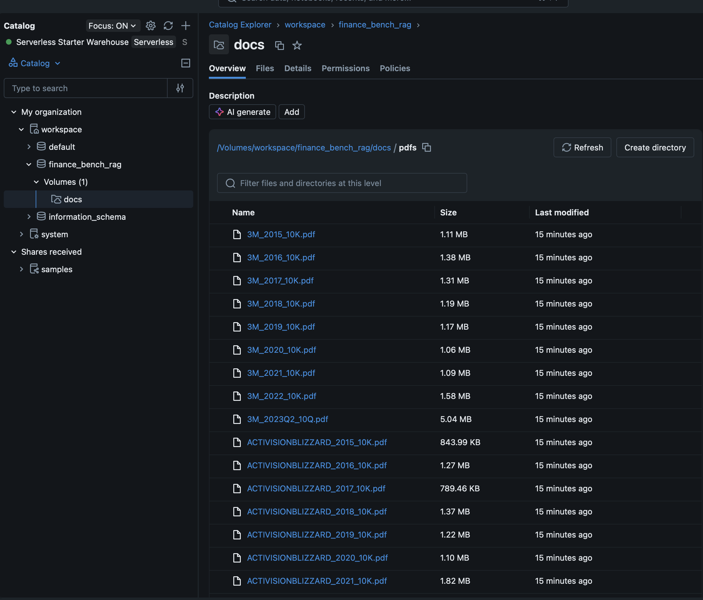
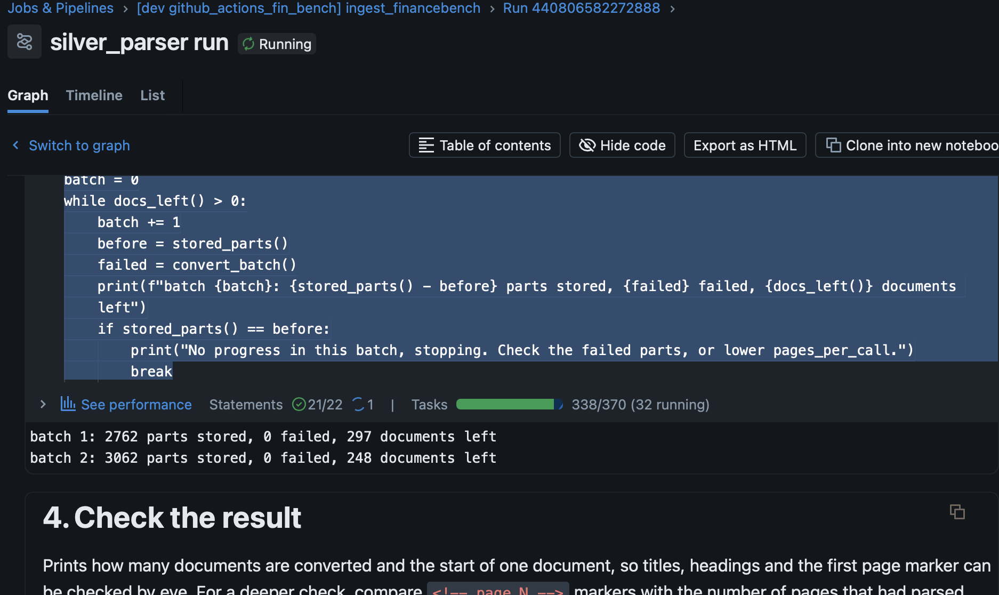
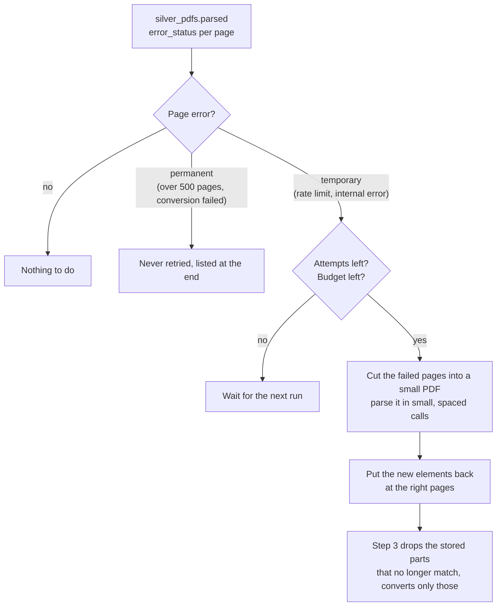

# dbx-finance-bench-rag

A RAG pipeline on Databricks over the [FinanceBench](https://github.com/patronus-ai/financebench) filings: 368 SEC filings (10-Ks, 10-Qs, 8-Ks), most of them 100 to 300 pages long. This repository covers the **ingestion**: getting the PDFs into Delta tables and turning them into clean Markdown text, ready for chunking and retrieval.

Everything is a Databricks Asset Bundle. Pushing a branch deploys it to `dev`, and merging to `master` deploys it to `prod` (see [doc/setup.md](doc/setup.md#4-cicd-with-github-actions)).

## At a glance


| Layer | Task | Output | Status |
| --- | --- | --- | --- |
| Download | `download` | PDFs in a Unity Catalog volume | Done |
| Bronze | `bronze_pdfs` | Table `bronze_pdfs`: raw PDF bytes | Done |
| Silver | `silver_parser` | Table `silver_pdfs`: parsed layout and **Markdown** | Done: 359 of 368 filings converted. See [results](#results) |
| Gold | not started | Chunks and embeddings | Next |

The three tasks run in order in the job `ingest_financebench`:


Every task is **safe to rerun**: each one remembers what it has already done and only processes what is new.

## 1. Download

Downloads all FinanceBench PDFs into the volume `/Volumes/<catalog>/<schema>/docs/pdfs/`. Files already in the volume are skipped.



Details: [doc/download/download.md](doc/download/download.md)

## 2. Bronze: raw PDFs

Loads the PDFs, as is, into the Delta table `bronze_pdfs` (`path`, `modificationTime`, `length`, `content`) with Auto Loader. A checkpoint means each run loads only new files. The first run loaded all 368 PDFs.


Details: [doc/medallion/bronze/bronze.md](doc/medallion/bronze/bronze.md)

## 3. Silver: PDFs to Markdown

Turns each filing into **one Markdown document** that keeps its structure: titles, headings, plain text, tables, page headers and footers, and page separators. The code, with an explanation of every stage, is in [src/silver_pdfs.ipynb](src/silver_pdfs.ipynb).

**One table, `silver_pdfs`:**

| Column | Meaning |
| --- | --- |
| `path` | Volume path of the PDF |
| `parsed` | `ai_parse_document` output (VARIANT): every element with its type, content and page |
| `markdown` | The final Markdown document. NULL until every part is converted |
| `parts` | `MAP<INT, STRING>`: Markdown of each converted part, by part number |
| `num_parts` | Number of parts of the document |

### How it works

1. **Parse.** A stream reads `bronze_pdfs` and runs `ai_parse_document` (version 2.0) on each new PDF. The result lists typed elements (title, section header, text, table, figure, page header, page footer, ...), each with its page. A streaming checkpoint means a PDF is parsed once, however often the job runs.
2. **Validate the parse.** Pages the parser failed on (rate limit, internal error) are re-parsed on their own, within a budget (step 2b, below).
3. **Split.** Each parsed document is split into **parts of 3 pages**, because the model can return at most 10,000 tokens per call (see the first challenge below).
4. **Convert.** Each part goes to `ai_query` with a prompt that asks for headings (`#`, `##`), plain text, Markdown tables, italic page headers and footers, and `<!-- page N -->` markers, with nothing summarized or reworded. The calls run in parallel on the cluster.
5. **Check the markers.** The model sometimes repeats or skips a `<!-- page N -->` marker, so each result's markers are checked against the part's page numbers. A part that fails is redone one page per call (where a single marker is easy to get right) and stitched together in code.
6. **Store and join.** Successful parts are saved in `parts`. When a document has all its parts, they are joined in order with `---` into `markdown`.
7. **Repeat in batches.** The cell works through the documents 50 at a time, saving each batch before starting the next, so **one job run converts everything** and a failure loses at most one batch.



Each log line is one batch: how many parts were stored, how many calls failed and how many documents are left.

### Example

`ai_parse_document` returns typed elements. For the first page of the Boeing 2022 10-K:

| type | page | content |
| --- | --- | --- |
| figure | 0 | BOEING |
| text | 0 | UNITED STATES SECURITIES AND EXCHANGE COMMISSION Washington, D.C. 20549 |
| title | 0 | FORM 10-K |
| text | 0 | (Mark One) |

`ai_query` turns them into Markdown, with the page marker and the title as a heading:

```markdown
<!-- page 1 -->
*BOEING*
UNITED STATES
SECURITIES AND EXCHANGE COMMISSION
Washington, D.C. 20549

# FORM 10-K

(Mark One)
```

A table (given by the parser as HTML) comes out as a Markdown table:

```markdown
| Union | Percent of our Employees Represented | Status of the Agreements with Major Union |
| --- | --- | --- |
| The International Association of Machinists and Aerospace Workers (IAM) | 20% | We have two major agreements; one expiring in September 2024 and one in July 2025. |
| The Society of Professional Engineering Employees in Aerospace (SPEEA) | 10% | We have two major agreements expiring in October 2026. |
```

Pages are separated by a blank line, `---`, a blank line and `<!-- page N -->`.

### Challenges and solutions

These are real problems hit while building and testing the layer.

| # | Challenge | Impact | Solution |
| --- | --- | --- | --- |
| 1 | The model endpoint caps output at **10,000 tokens** | A whole filing in one call was cut off silently: a 150-page filing came back as about 43,000 characters | Split each document into parts of a few pages, one `ai_query` call each, then join |
| 2 | The page number is in `bbox[0].page_id`, not on the element | Every element had a NULL page, so each document became one page and one part, and challenge 1 came back | Read the page from `bbox[0].page_id` (verified: 1,042 elements spread over 150 pages) |
| 3 | A failure late in a long run would lose everything | A rerun would pay again for thousands of `ai_query` calls | Store each successful part. A rerun sends only the missing parts. Save per batch of documents |
| 4 | A part that can never succeed would loop forever | Wasted money | The loop stops when a batch stores no new part |
| 5 | Parsing is slow and billed per document | Reparsing on every run | Streaming checkpoint: each PDF is parsed once |
| 6 | The configured model endpoint did not exist, and `ai_query` rejected `max_tokens` above the endpoint's cap | The job failed in step 3 | List endpoints with `databricks serving-endpoints list`. Use `databricks-qwen3-next-80b-a3b-instruct` with `max_tokens` 10,000 |
| 7 | `ai_query` with `failOnError => false` returns `result` and `errorMessage` | Reading a field called `response` failed with `FIELD_NOT_FOUND` | Read `r.result` |
| 8 | The table already existed with fewer columns | `CREATE TABLE IF NOT EXISTS` does not add columns | `ALTER TABLE ... ADD COLUMNS` when `parts` is missing |
| 9 | Some PDFs cannot be parsed at all: `ai_parse_document` rejects PDFs over 500 pages and sometimes fails a conversion | Such a document has no elements, so it never produces a part. In the first full run these were picked first in every batch, a batch stored nothing and the loop stopped with 189 convertible documents left | Step 3 only picks documents with parsed elements, and lists the skipped ones with the parser's reason |
| 10 | Calls could run one after another when few partitions held the parts | Slow conversion | `repartition(32)` spreads the calls over the workers |
| 11 | The model repeats or skips `<!-- page N -->` markers (found by checking all 359 documents: 151 had a different marker count than pages, off by 1 to 11) | Page numbers in the Markdown cannot be trusted | Validate every part's markers against its page numbers. Redo a bad part one page per call, where the marker is added in code (the model sometimes mistook the printed page number for a marker, which made 10 parts fail even page by page), and stitch the pages in code |
| 12 | `ai_parse_document` failed on some pages: `Request rate limit exceeded` (2,815 pages in 53 documents) and `Internal error` (365 pages in 11 documents). Found with the inspection notebook | About 6% of the pages (3,180 of 49,965 in the converted documents) have no content, so they are missing from the Markdown. PepsiCo 2018 lost 278 of 479 pages | Step 2b: validate the parse, re-parse only the failed pages within a page budget, reconvert only the parts that changed (see the section above) |

### Validating the parse and re-parsing failed pages (step 2b)

`ai_parse_document` sometimes answers a page with an error instead of content, mostly when many PDFs are parsed at once. In the first full run **3,180 of 49,965 pages (6%) failed**, in 55 documents. Those pages have no text, so they were missing from the Markdown. Step 2b finds them and parses only them again. It is built for a limited quota (the Databricks free tier): it spends as little as it can, and it never spends more than a budget you set.

**How it decides what to do**



| Guard | What it does | Why |
| --- | --- | --- |
| Validate first | Reads the parser's own `error_status`. Only temporary errors (rate limit, internal error) are retried. A PDF over 500 pages or a failed conversion is never retried | A retry that cannot work is wasted quota |
| Re-parse only the failed pages | Builds a small PDF from just those pages (PyMuPDF) and parses that | Re-parsing the 55 documents whole would bill 11,870 pages. This bills 3,180 |
| Page budget per run | `reparse_page_budget`, default 300 pages | A large backlog is worked off over several runs, and one run can never spend more than the budget |
| Small, spaced calls | `reparse_chunk_pages` pages per call (default 20), `reparse_pause_seconds` between calls (default 10), one document at a time | The rate limit that caused the errors is not hit again |
| Stop on rate limit | If more than half of a call's pages fail again, the run stops | Do not keep spending while the service is limiting |
| Attempt cap | `parse_attempts` counts failed passes. After `reparse_max_attempts` (default 3) the document is left alone | A page that always fails cannot loop forever |
| Dry run | `reparse_dry_run = yes` prints the plan (documents, pages, what a whole re-parse would cost) and spends nothing | Look before spending |
| One document | `reparse_doc` limits the run to one document | A cheap test |
| Reconvert only what changed | After a re-parse, step 3 compares each stored part's page markers with the pages the new parse puts in that part, **without any `ai_query` call**, and drops only the parts that differ | Parts before the first changed page are kept. Only the changed parts are paid for again |
| Conversion budget | `max_parts_per_run`, default 1000 parts | The `ai_query` spend of one run is capped too |

**Why page numbering is not changed.** Pages are still counted 1, 2, 3 over pages that have content. Changing to true PDF page numbers would invalidate the stored parts of 48 other documents that have genuinely empty pages, and cost many extra `ai_query` calls.

**Running it safely**

1. Look: set `reparse_dry_run` to `yes` and run. It prints the plan and spends nothing.
2. Test: set `reparse_doc` to one document and `reparse_page_budget` to a small number.
3. Then run normally. Each run re-parses up to the budget and converts what changed. Repeat until the plan is empty.

The inspection notebook ([src/inspect_parsed.ipynb](src/inspect_parsed.ipynb)) shows the parser errors of any document and which pages are missing.

### Results

Quality check on three filings in the dev job. Every part completed, and each Markdown ends where the filing ends, with the signature block.

| Document | PDF pages | Pages with parsed content | Page markers | Parts | Markdown size |
| --- | --- | --- | --- | --- | --- |
| Lockheed Martin 2020 10-K | 132 | 112 | 112 | 38 / 38 | 465k characters |
| Boeing 2022 10-K | 190 | 115 | 115 | 39 / 39 | 335k |
| Corning 2015 10-K | 273 | 270 | 270 | 90 / 90 | 922k |

- One `<!-- page N -->` marker per page that had parsed content. The PDF page count is higher than the pages with content because `ai_parse_document` failed on some pages with `Request rate limit exceeded` or `Internal error` (found with the inspection notebook; see challenge 12). Those pages are missing from the Markdown.
- Headings and Markdown tables are present in all three.

**Full run.** The first full run of the batch loop converted 142 documents in three batches (8,060 parts, no failed calls) before it stopped on the unparseable PDFs (challenge 9). After the fix, the next run converted the remaining 189 documents in four batches. See the totals below.

### Full-run totals

| | |
| --- | --- |
| Filings in `silver_pdfs` | 368 |
| **Converted to Markdown** | **359** |
| Not parsable by `ai_parse_document` | 9 (7 over the 500-page limit, 2 failed conversions) |
| Parts converted with `ai_query` | 15,660 |
| Failed `ai_query` calls | 0 |
| Documents with wrong or missing page markers | 0 (was 151) |
| Average Markdown size per filing | about 467,000 characters |
| Largest Markdown document | about 1.7 million characters |
| Time of the last run (189 documents, parallel) | about 22 minutes |

**Page marker check (after the validation fix).** All 359 converted documents were checked: none has a part with wrong markers, and none has a different number of `<!-- page N -->` markers than pages with content. Before the fix, 162 documents had at least one bad part (369 of 15,660 parts) and 151 had a different marker count. The repair redid only those 369 parts. It took 5 batches, the page-by-page fallback fixed most, and the last 10 parts needed the marker added in code.

The batch log of the full run (before the marker check):

```
batch 1: 2731 parts stored, 0 failed, 139 documents left
batch 2: 1697 parts stored, 0 failed, 89 documents left
batch 3: 924 parts stored, 0 failed, 39 documents left
batch 4: 721 parts stored, 0 failed, 0 documents left
```

The nine skipped filings are listed with the parser's reason at the end of the silver notebook: six PepsiCo 10-Ks (2016, 2017, 2019, 2020, 2021, 2022) and the PG&E 2021 10-K are over the page limit, and two Intel 8-Ks failed conversion.

### Limits and next steps

- **Cost:** `ai_parse_document` and `ai_query` are billed per use. A 150-page filing is about 50 `ai_query` calls, so the full set is on the order of 15,000 calls.
- **Parser page errors:** handled by step 2b within a page budget, so a large backlog takes several runs. Pages that keep failing after the attempt cap stay missing and are listed by the inspection notebook.
- **Unparseable PDFs:** 9 of 368 filings (7 over the 500-page limit, 2 failed conversions) have no `markdown`, so silver covers 359 filings. Handling them means splitting the PDF into smaller files before parsing.
- **Model-written separators:** the `<!-- page N -->` markers inside a part are written by the model, and are checked after the fact (see challenge 11). The `---` between parts is added in code. The inspection notebook lists every document whose markers do not match its pages.
- **Changed or deleted PDFs:** not handled. Bronze tracks files by path, and silver keeps rows of deleted files. See [happy_unhappy_path.md](doc/medallion/silver/happy_unhappy_path.md).
- **Failure reasons are not stored:** failed parts are counted in the log but their error messages are not saved.
- **Table accuracy:** table cells were checked by eye on a sample, not measured against the PDF.
- **Next layer:** gold chunks the Markdown (for example by heading or page) and creates embeddings.

### Inspecting a parsed document

[src/inspect_parsed.ipynb](src/inspect_parsed.ipynb) is a helper notebook, outside the job, for looking at what the parser produced. For one PDF it shows:

- an overview (pages, element types, parser errors);
- the PDF page with a coloured box around every parsed element, by type and reading order, like the Databricks parse viewer;
- the page's elements as a table;
- the parsed text next to the Markdown for the same page;
- a check of the page markers (missing, repeated, out of range);
- optionally, the marker and size check for all documents, to find the ones to look at.

## Run it

```bash
databricks bundle deploy -t dev
databricks bundle run ingest_financebench -t dev
```

Silver parameters (notebook widgets):

| Widget | Default | Meaning |
| --- | --- | --- |
| `catalog`, `schema` | `workspace`, `finance_bench_rag` | From the bundle variables |
| `endpoint` | `databricks-qwen3-next-80b-a3b-instruct` | Model serving endpoint used by `ai_query` |
| `max_files_per_batch` | `10` | Parse step: bronze files per micro-batch |
| `reparse_page_budget` | `300` | Step 2b: max pages re-parsed per run |
| `reparse_max_attempts` | `3` | Step 2b: failed passes before a document is left alone |
| `reparse_chunk_pages`, `reparse_pause_seconds` | `20`, `10` | Step 2b: pages per parse call, pause between calls |
| `reparse_doc`, `reparse_dry_run` | empty, `no` | Step 2b: one document only; `yes` prints the plan and spends nothing |
| `max_parts_per_run` | `1000` | Step 3: stop after this many new parts |
| `pages_per_call` | `3` | Pages per `ai_query` call. Lower it if parts fail |
| `docs_per_batch` | `50` | Documents per save point |

- **Rerun or redeploy:** safe. Nothing already stored is parsed or converted again.
- **Redo only the prompt:** `UPDATE silver_pdfs SET markdown = NULL, parts = NULL, num_parts = NULL`, then rerun. The parse is kept.
- **Full rebuild:** drop `silver_pdfs`, delete the checkpoint folder `/Volumes/<catalog>/<schema>/docs/_checkpoints/silver_pdfs` and rerun. Dropping only the table leaves the checkpoint, so nothing would be reparsed.

## More documentation

| Doc | Contents |
| --- | --- |
| [doc/setup.md](doc/setup.md) | CLI install, authentication, deploying the bundle, CI/CD, GitHub secrets, Unity Catalog grants |
| [doc/download/download.md](doc/download/download.md) | How the PDF download works |
| [doc/medallion/bronze/bronze.md](doc/medallion/bronze/bronze.md) | The bronze table and the Auto Loader load |
| [doc/medallion/silver/silver.md](doc/medallion/silver/silver.md) | Silver in more detail: stages, parameters, operations |
| [doc/medallion/silver/happy_unhappy_path.md](doc/medallion/silver/happy_unhappy_path.md) | Edge cases and open decisions for silver |
| [src/silver_pdfs.ipynb](src/silver_pdfs.ipynb) | The silver notebook, with an explanation cell for every stage |
| [src/inspect_parsed.ipynb](src/inspect_parsed.ipynb) | Helper to inspect a parsed document: page view with element boxes, parsed text vs Markdown, marker check |
