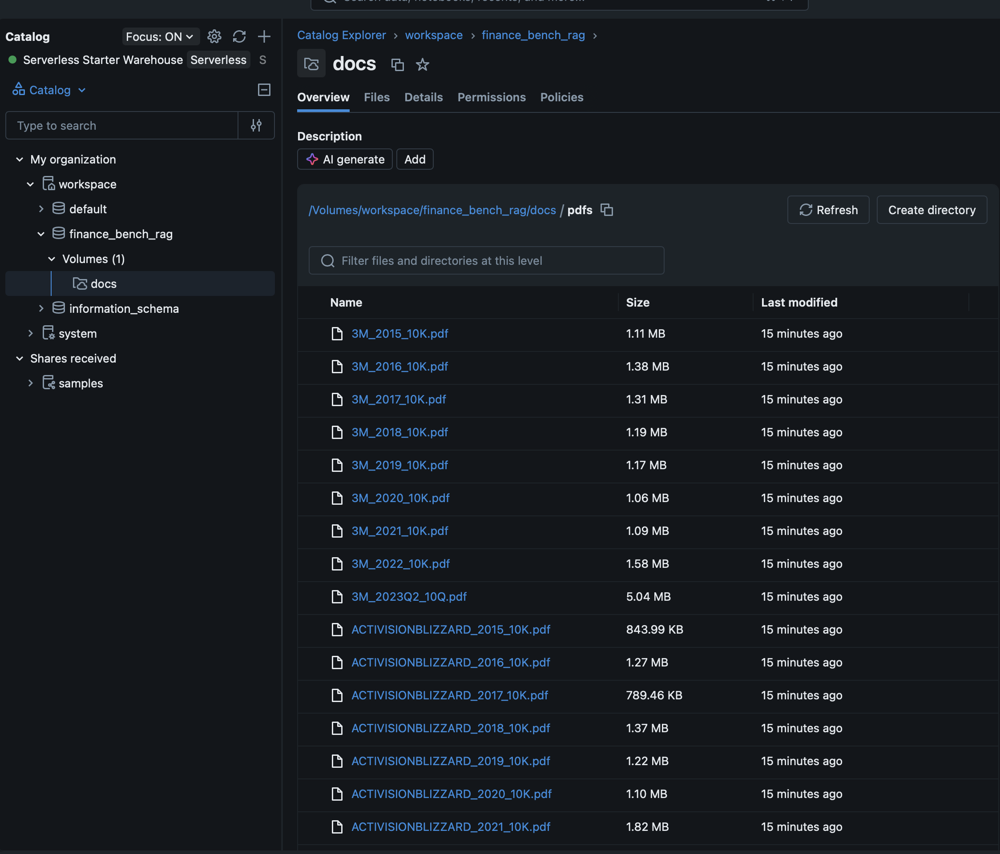
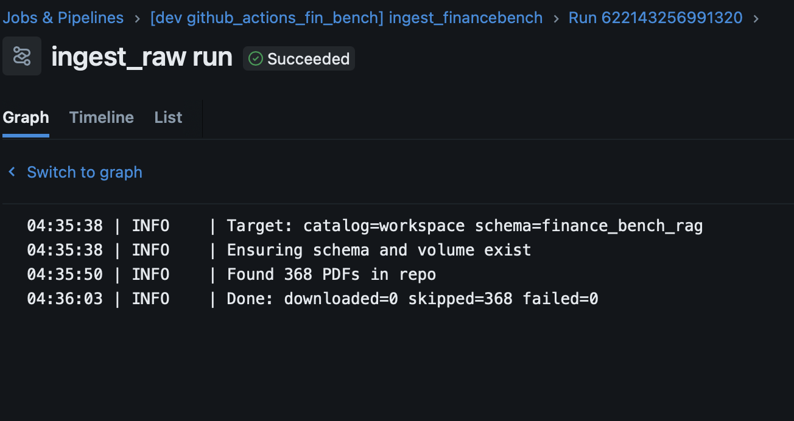

# Ingestion, part 1: Download

This is the first task, `download`, of the `ingest_financebench` job. The second task loads the PDFs into the bronze table: [part 2, bronze layer](../medallion/bronze/bronze.md).

[src/ingest/download.py](../../src/ingest/download.py) downloads every PDF from the public
[patronus-ai/financebench](https://github.com/patronus-ai/financebench) `pdfs/` folder into a Unity Catalog volume.



## What it does

With `--match <regex>` and `--limit <n>` it downloads only a sample: the dev target uses `--match EARNINGS --limit 5` (five short earnings releases) so that testing is cheap. Prod downloads all 368.

1. Creates the schema and the `docs` volume if they don't exist (`IF NOT EXISTS`).
2. Lists the PDFs in the repo with one GitHub API call.
3. Downloads each PDF to `/Volumes/<catalog>/<schema>/docs/pdfs/`.
4. Skips any file already in the volume, so reruns are cheap. A rerun that has nothing to do logs `downloaded=0 skipped=<n> failed=0`.
5. Logs each download as `[i/total] downloaded <name> (<size> MB)`. Failed downloads are logged and reported together at the end, and the job fails.

## Idempotent reload

The load is idempotent: the script was rerun after the first pass had already downloaded everything. It found all 368 PDFs in the repo, skipped every one because it was already in the volume, and downloaded nothing. The run still succeeded.



## Running it

The job `ingest_financebench` is defined in [resources/ingest_job.yml](../../resources/ingest_job.yml). It runs on serverless compute and receives `--catalog` and `--bronze-schema` from the bundle variables in [databricks.yml](../../databricks.yml).

```bash
databricks bundle deploy -t dev
databricks bundle run ingest_financebench -t dev
```

## Next

The `bronze_pdfs` task runs after this one and loads the PDFs into a Delta table: [part 2, bronze layer](../medallion/bronze/bronze.md).

## Requirements

The service principal needs the Unity Catalog grants listed in [setup.md](../setup.md#one-time-setup).

## Notes

- Only the file name is checked, so a PDF that changes upstream is not re-downloaded.
- The GitHub API allows 60 unauthenticated calls per hour per IP. The job uses one.
