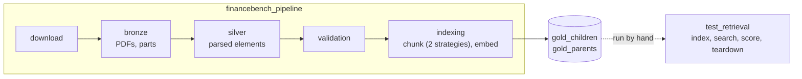

# Indexing and retrieval

What comes after silver. The details are in [gold.md](../medallion/gold/gold.md) and
[test_retrieval.md](../retrieval/test_retrieval.md).

## Where it fits

- **Input:** `silver_parsed`, the parser's elements. They already have the headings and the tables, and no model
  rewrites the numbers (silver's Markdown conversion was removed, see the [README](../../README.md#why-there-is-no-markdown-step)).
- **`indexing`** (in the pipeline): chunks every complete filing with both strategies and embeds the chunks.
  Everything it writes is kept.
- **`test_retrieval`** (by hand, one notebook): builds a Vector Search index from the stored vectors, scores the
  retrievers on FinanceBench, and deletes the index and the endpoint again.

## Decisions

| Question | Decision |
| --- | --- |
| Chunking strategies | `structured` (sections by heading, whole tables, parent-child) and `fixed` (600 tokens, the baseline). One chunk per page was dropped: pages vary a lot in size, cut tables and mix topics |
| Tables | Two: `gold_children` (searched, both strategies, a `strategy` column) and `gold_parents` (what the LLM reads for structured). Fixed has no parents |
| Embedding model | `databricks-gte-large-en` (1024 dimensions), on `embed_text`: a prefix line (company, form, year, section) and the child's text |
| Where the vectors live | In `gold_children.embedding`, filled once per chunk. The index is built from them, so deleting it costs no embedding |
| Vector Search | One Delta Sync index on `gold_children`, filtered by `strategy` and filing, `TRIGGERED`. Created and deleted by `test_retrieval`, never left running |
| Retrieval | LangChain: parent-child (search children, return parents) with Vector Search `hybrid`, or an `EnsembleRetriever` of vector and BM25 |
| Quality measure | FinanceBench: the evidence page in the top k (also the filing, the evidence text, MRR) |

## Open

- [ ] First runs on dev, then prod (see "Not checked yet" on both pages)
- [ ] Which strategy and search mode win, from `test_retrieval_results`
- [ ] Finding the filing from the question (company and year), for questions that do not name it
- [ ] Reranker: a hosted model or a cross-encoder
- [ ] Answer quality: the LLM's answer against FinanceBench's
