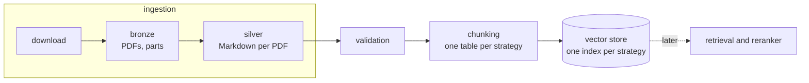

# Indexing (planned)

Not built yet. This page keeps the idea so the next step starts from a plan.

## Where it fits

All of it runs as tasks of the parent job `financebench_pipeline`.

- **Input:** the view `silver_documents`. It only shows PDFs whose pages are all converted, so indexing never sees a half document. Page markers (`<!-- page N -->`) are in the text, so a chunk can keep its page number for citations.
- **Job:** a separate job, `indexing`, in its own `resources/indexing_job.yml` and `src/indexing/`. It is added to [financebench_pipeline_job.yml](../../resources/financebench_pipeline_job.yml) as the last task. Ingestion is not re-run to try a new chunking: parsing is the expensive part, and it is already stored.

## Steps

| Step | What | Output |
| --- | --- | --- |
| 1. Chunking | Split each document into chunks. Several strategies are tried and compared | A chunks table per strategy, each row keeping `path`, `page_no` and the strategy name |
| 2. Vector store | Embed the chunks and index them | A Databricks Vector Search index per strategy |
| 3. Reranker (later) | Re-order the retrieved chunks before they go to the model | Part of the retrieval step, not of indexing |

## Chunking strategies to try

Decided later, when we compare them. Candidates:

- Fixed size with overlap (the baseline)
- By page (the natural unit of silver)
- By section, using the Markdown headings
- Table-aware: a table is never split

Each strategy is a task or a job parameter (`chunking_strategy`) and writes its own table, so strategies can be compared on the same questions without touching each other.

## How the strategies will be compared

FinanceBench has questions with reference answers and evidence pages. For each strategy: retrieve for every question, then measure whether the evidence page is in the top k. Details are written when this is built.

## Open decisions

- [ ] Embedding model (a Databricks endpoint)
- [ ] Vector Search: availability and limits on the free tier
- [ ] One index per strategy, or one index with a `strategy` column
- [ ] How to measure retrieval quality (top-k hit on the evidence page)
- [ ] Reranker: a hosted model or a cross-encoder
