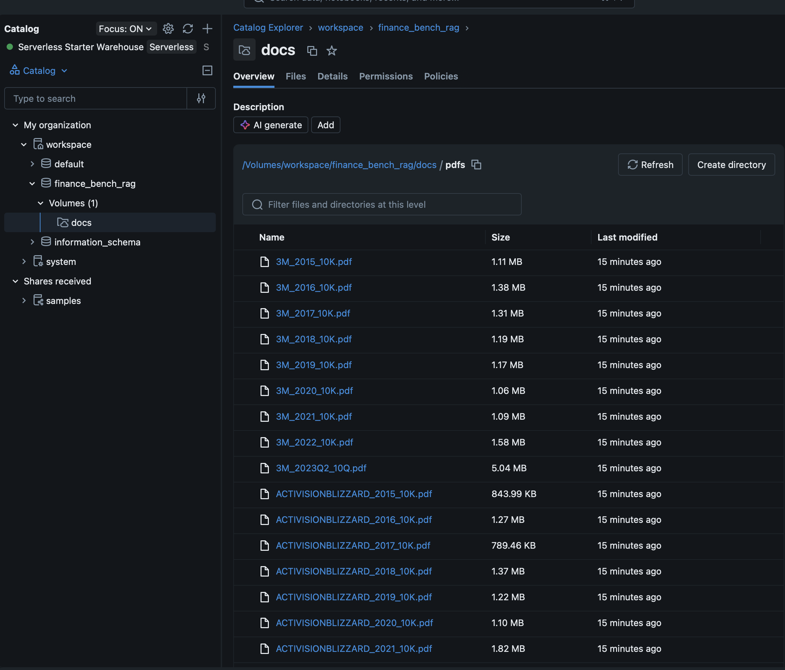

# Ingestion: raw PDFs

[src/ingest_raw.py](../../src/ingest_raw.py) downloads every PDF from the public
[patronus-ai/financebench](https://github.com/patronus-ai/financebench) `pdfs/` folder into a Unity Catalog volume.



## What it does

1. Creates the schema and the `docs` volume if they don't exist (`IF NOT EXISTS`).
2. Lists the PDFs in the repo with one GitHub API call.
3. Downloads each PDF to `/Volumes/<catalog>/<schema>/docs/pdfs/`.
4. Skips any file already in the volume, so reruns are cheap. A rerun that has nothing to do logs `downloaded=0 skipped=<n> failed=0`.
5. Logs each download as `[i/total] downloaded <name> (<size> MB)`. Failed downloads are logged and reported together at the end, and the job fails.

## Running it

The job `ingest_financebench` is defined in [resources/ingest_job.yml](../../resources/ingest_job.yml). It runs on serverless compute and receives `--catalog` and `--schema` from the bundle variables in [databricks.yml](../../databricks.yml).

```bash
databricks bundle deploy -t dev
databricks bundle run ingest_financebench -t dev
```

## Requirements

The service principal needs the Unity Catalog grants listed in [setup.md](../setup.md#one-time-setup).

## Notes

- Only the file name is checked, so a PDF that changes upstream is not re-downloaded.
- The GitHub API allows 60 unauthenticated calls per hour per IP. The job uses one.
