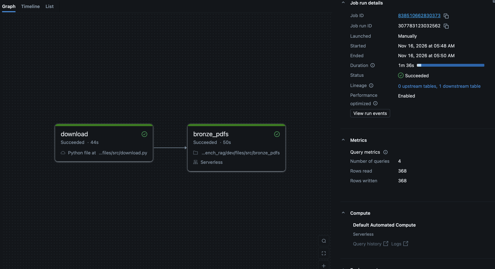
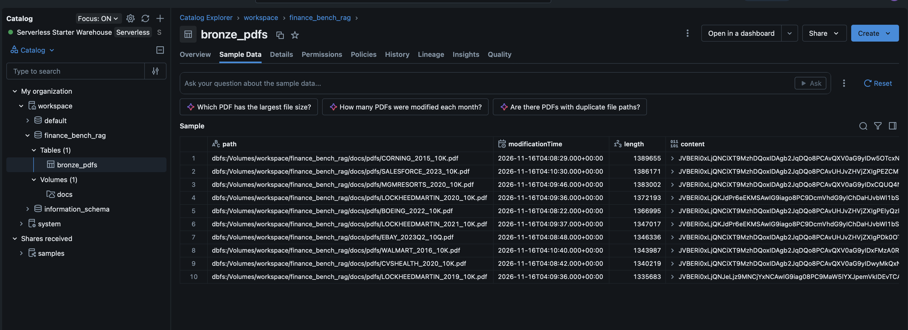

# Ingestion, part 2: Bronze layer

The bronze layer has its own schema (`finance_bench_bronze`, dev `finance_bench_bronze_dev`) and two tasks of the `ingest_financebench` job. `bronze_pdfs` runs after [part 1, download](../../download/download.md) and loads the PDFs from the volume into the Delta table `bronze_pdfs`, as is. `bronze_split` then cuts the PDFs of more than 50 pages into parts and stores them in `bronze_pdf_parts`. Nothing is parsed or transformed: the parts are still raw bytes. Silver (parsed plain text) and gold (chunked text) come later.

```
download  -->  /Volumes/<catalog>/<bronze_schema>/docs/pdfs/*.pdf  -->  bronze_pdfs  -->  bronze_pdf_parts
```



The code and a step-by-step explanation are in the notebook [src/bronze/bronze_pdfs.ipynb](../../../src/bronze/bronze_pdfs.ipynb). The task is defined in [resources/ingest_job.yml](../../../resources/ingest_job.yml) and receives `catalog` and `bronze_schema` from the bundle variables in [databricks.yml](../../../databricks.yml).

## Table

| Column | Meaning |
| --- | --- |
| `path` | Full volume path |
| `modificationTime` | File modification time |
| `length` | File size in bytes |
| `content` | Raw PDF bytes |



## How it loads

The load is incremental. It uses [Auto Loader](https://docs.databricks.com/aws/en/ingestion/cloud-object-storage/auto-loader/) (`cloudFiles`, `binaryFile` format) with `trigger(availableNow=True)`, so each run loads only the PDFs it has not seen, appends them and stops. Auto Loader records processed files in a checkpoint at `/Volumes/<catalog>/<bronze_schema>/docs/_checkpoints/bronze_pdfs`.

The first run, shown in the job graph above, read and wrote 368 rows, one per PDF, in about 50 seconds on serverless compute.

## The parts: `bronze_pdf_parts`

Silver reads this table, never the whole PDFs. The task `bronze_split` ([src/bronze/split_pdfs.ipynb](../../../src/bronze/split_pdfs.ipynb), logic in [splitting.py](../../../src/bronze/splitting.py)) cuts every PDF with more than `part_pages` pages (50, dev 5) into parts and appends them. A PDF with `part_pages` pages or fewer is one part.

| Column | Meaning |
| --- | --- |
| `path` | The path of the original PDF |
| `part_no` | 1, 2, 3, ... |
| `page_offset` | Pages before this part. The real page number is `page_offset + page_id + 1` |
| `pages` | Pages in this part |
| `content` | The bytes of the part (a PDF) |
| `split_at` | When it was cut |

**Why parts.** The parser throttles (`Request rate limit exceeded`) on long PDFs and a failed page throws away the whole parse. A 155-page filing lost 27 pages whole and came back complete in four parts. A part that fails is retried alone, at most 50 pages, and the 500-page limit of the parser no longer matters.

Only PDFs without parts are cut, one at a time, so a rerun does nothing. A PDF that cannot be read is one part with its original bytes, and the parser decides.

## Running it

```bash
databricks bundle deploy -t dev
databricks bundle run ingest_financebench -t dev
```

## Requirements

The service principal needs the Unity Catalog grants listed in [setup.md](../../setup.md#one-time-setup), plus write access to the volume.

## Notes

- Files are tracked by path, so a PDF that changes upstream under the same name is not reloaded.
- To rebuild from scratch, drop the bronze schema and rerun. The PDFs are downloaded again (free) and cut again. To reload only `bronze_pdfs`, drop it and delete its checkpoint folder: dropping only the table leaves the checkpoint, so nothing would be reloaded.
- No file arrival trigger is needed. The `download` task writes the PDFs in the same job run.
