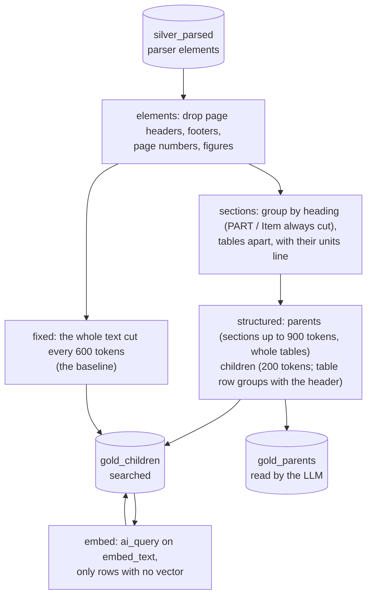

# Gold layer: chunks and embeddings

Gold has its own schema (`finance_bench_gold`, dev `finance_bench_gold_dev`). It is built by the job `indexing`,
the last step of `financebench_pipeline`. It reads the **parser's elements** in `silver_parsed`: they already say what is a heading and what is a table
(tables as HTML), and no model sits between the filing and the numbers (silver used to convert the pages to Markdown
with a model, which was removed, see the [README](../../../README.md#why-there-is-no-markdown-step)).

## Flow



The tasks `chunk_structured` and `chunk_fixed` run at the same time (the same notebook, `strategy` differs), then
`embed`.

## The strategies

| | `structured` (main) | `fixed` (baseline) |
| --- | --- | --- |
| Cut by | Headings: a PART or Item heading always starts a section, a smaller one only when the current section has 100 tokens | Size only |
| Tables | Never split, never mixed with prose. The short line before a table (its title, "(in millions)") goes with it. A table continued on the next page is merged into one | Rendered as rows and cut like the text |
| What is searched (`gold_children`) | Children: about 200 tokens of a parent (30 tokens overlap); for a table, row groups that each repeat the units line and the header row | Chunks of about 600 tokens (60 overlap) |
| What the LLM reads | The parent: the section (up to 900 tokens) or the whole table | The chunk itself |
| `gold_parents` | One row per parent | Nothing |

Splitting is LangChain's `RecursiveCharacterTextSplitter` (paragraph, line, sentence, word), sizes in tiktoken
tokens (`cl100k_base`). Every chunk keeps its pages (`page_start`, `page_end`): a parent packs whole elements, so
its pages are exact; a child has its parent's pages.

**Embedded text.** Only `embed_text` is embedded: a prefix line, then the child's text. The prefix is what lets a
child of bare numbers match "Boeing 2022 operating income":

```
BOEING 10K 2022 | PART II > Item 8. Financial Statements

(in millions)
| | 2022 | 2021 |
| --- | --- | --- |
| Revenue | 66,608 | 62,286 |
```

`parent_text` is copied onto every child, so one search returns what the LLM reads. It is not embedded.

## Tables

| Name | Holds |
| --- | --- |
| `gold_children` | Every searchable chunk of both strategies: `chunk_id` (key), `strategy`, `parent_id` (empty for fixed), `path`, `company`, `fiscal_period`, `doc_type` (from the file name), `chunk_no`, `chunk_type` (text, table), `heading_path`, `page_start`, `page_end`, `text`, `embed_text`, `parent_text`, `n_tokens`, `embedding`, `chunked_at`. Change Data Feed is on, for the Delta Sync index |
| `gold_parents` | The structured parents: `parent_id`, `parent_no`, the same filing columns, `chunk_type`, `heading_path`, pages, `text`, `n_tokens` |
| `test_retrieval_results` | The scores of every `test_retrieval` run (see [test_retrieval.md](../../retrieval/test_retrieval.md)) |
| volume `cache` | tiktoken's vocabulary, for the workers |

## How it runs

- **Only what is missing.** A filing is chunked when all its parts are in `silver_parsed` and it has no chunks of
  that strategy yet. A chunk is embedded when it has no vector yet. Rows are inserted by key (`chunk_id`, a hash of
  the strategy, the file and the chunk number), so a rerun adds nothing twice.
- **In parallel.** `applyInPandas`, one group per filing, on serverless. The gold modules are shipped to the
  workers with the function (cloudpickle by value), LangChain and tiktoken come from `%pip`. If the workers cannot
  run it, set the widget `parallel` to `false`: the same function runs on the driver.
- **tiktoken on the workers.** tiktoken downloads its vocabulary on first use, and workers may have no internet
  access. The driver downloads it once into the volume `cache`, and the workers read it from there.
- **Save points.** 50 filings per batch (`pdfs_per_batch`), 2,000 chunks per embedding batch (`batch_size`), each
  saved before the next. Serverless compute has no `cache()`, so each chunk batch is written once to a staging
  table (`_chunks_staging_<strategy>`) and both gold tables are filled from it.
- **Each chunk is embedded once.** The vectors are stored in `gold_children`, not only in an index, so the
  Vector Search index can be deleted and built again without paying for embeddings again.

## Operations

```sql
-- Chunks per strategy, and how big they are
SELECT strategy, chunk_type, count(DISTINCT path) AS filings, count(*) AS chunks, avg(n_tokens), max(n_tokens)
FROM gold_children GROUP BY ALL;

-- Look at one filing's structured parents in order
SELECT parent_no, chunk_type, heading_path, page_start, page_end, text
FROM gold_parents WHERE path LIKE '%BOEING_2022_10K%' ORDER BY parent_no;

-- Chunks still without a vector (embed runs again on the next indexing run)
SELECT strategy, count(*) FROM gold_children WHERE embedding IS NULL GROUP BY strategy;
```

- **Chunk again with new settings:** `DELETE FROM gold_children WHERE strategy = 'structured'` and
  `DELETE FROM gold_parents` (or `strategy = 'fixed'` alone), then run `indexing`. The embeddings of the deleted
  chunks are paid again.
- **Gold rebuild:** drop the gold schema and run `indexing`. Silver is not touched, nothing is parsed again.

## Widgets

| Widget | Task | Default | Meaning |
| --- | --- | --- | --- |
| `strategy` | chunk | `structured` / `fixed` | Set by the task |
| `parent_tokens`, `child_tokens`, `child_overlap` | chunk | `900`, `200`, `30` | Structured sizes |
| `fixed_tokens`, `fixed_overlap` | chunk | `600`, `60` | Fixed sizes |
| `pdfs_per_batch` | chunk | `50` | Filings per save point |
| `parallel` | chunk | `true` | `false` runs the chunking on the driver |
| `embedding_endpoint` | embed | `databricks-gte-large-en` | Must be the model `test_retrieval` embeds questions with |
| `batch_size` | embed | `2000` | Chunks per save point |

## Not checked yet

The chunker is unit-tested (`tests/test_gold.py`, with a word count instead of tiktoken). It has **not run on
Databricks yet**. On the first dev run, check:

- That `section_header` and `title` are used by the parser the way the heading rules expect: look at the
  `heading_path` of two or three filings.
- That `applyInPandas` with the shipped modules works on serverless (else `parallel = false`), and that the
  workers read tiktoken's vocabulary from the volume.
- The size of the tables: a whole financial statement can be a parent of several thousand tokens.
