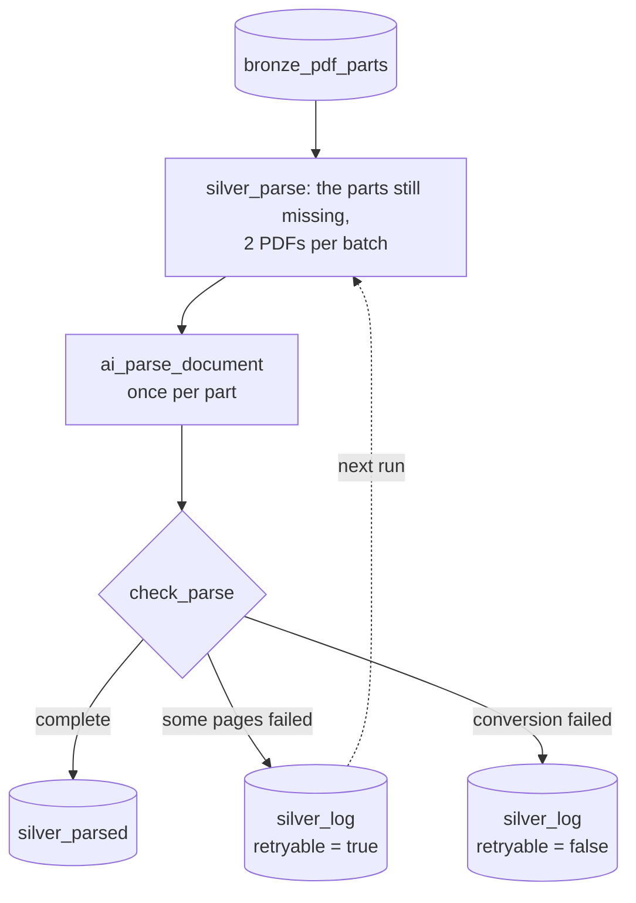
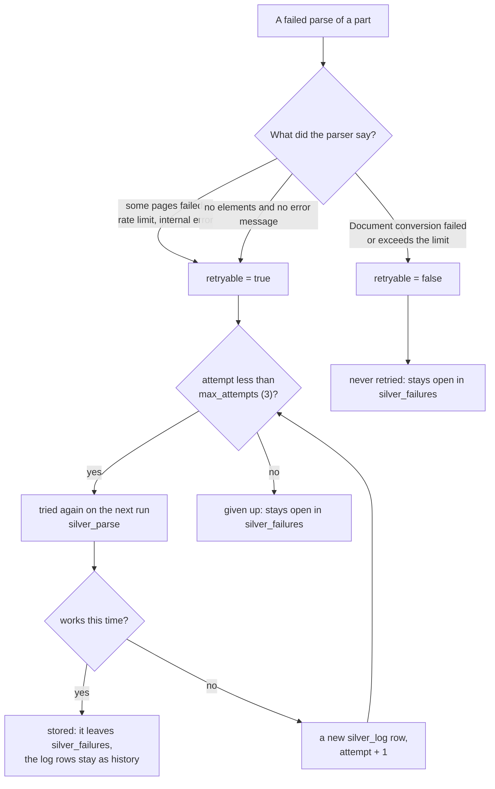

# Silver layer: operations

Silver has its own schema (`finance_bench_silver`, shared by dev and prod). It reads the parts of the PDFs from bronze (`bronze_pdf_parts`, see [bronze.md](../bronze/bronze.md)), and parses each part. The tables below are in the silver schema.

The design, the stages and the challenges are in the [README](../../../README.md#3-silver-pdfs-to-parsed-elements), and every stage is explained in its notebook in [src/silver/](../../../src/silver/). This page is for **running and looking after** the silver layer.

## Flow



## What is where

| Name | Kind | Holds |
| --- | --- | --- |
| `silver_parsed` | table | One row per part with a complete parse (`path`, `part_no`, `page_offset`, `parsed` VARIANT, `pdf_pages`, `pages`, `parsed_at`) |
| `silver_log` | table | The trail of every failed parse (`path`, `part_no`, `attempt`, `retryable`, `reason`, `pdf_pages`, `logged_at`). The columns `stage` (always `parse` now) and `page_no` (always empty) are left from the page conversion that was removed |
| `silver_failures` | view | What is still open: the parts not parsed, with the last reason |

The real PDF page of an element is the part's `page_offset` plus the parser's page id plus 1, also for a PDF cut into parts.

## `silver_log`: retryable and not retryable

Every failure is a row in `silver_log`. Nothing is ever deleted from it. `silver_failures` shows only what is still open: a failure is closed when its part is stored in `silver_parsed`.

| Column | Meaning |
| --- | --- |
| `part_no` | The part that failed to parse |
| `attempt` | 1 for the first failure, then 2, 3, ... Each failed try is a new row |
| `retryable` | Whether trying again can help |
| `reason` | The message from the parser |



| | Retryable (`true`) | Not retryable (`false`) |
| --- | --- | --- |
| **Parse** | `N pages failed: Request rate limit exceeded` or `Internal error`: the service was busy, the part itself is fine. Also a part with no elements and no error message | `Document conversion failed`: the parser cannot read the file, so a retry gives the same answer. (`Document has N pages, which exceeds the limit of 500` was the other case: it cannot happen now, because parts have at most 50 pages) |
| **Who retries it** | The next `silver_parse` run: a part is missing until it is parsed, and a retryable failure with `attempt` below `max_attempts` is parsed again. It is not tried again in the same run | Nobody. It stays in `silver_failures` for you to look at |
| **After `max_attempts`** | Left alone, still listed in `silver_failures`. Raise `max_attempts` for one run to try again | |

**The rule behind it.** A failure is retryable when the cause is outside the file (a busy service). It is not retryable when the file itself is the cause, because trying again would only spend quota for the same result.

**Today on prod:** 2 open failures, both not retryable: `INTEL_2023_8K_dated-2023-02-10.pdf` and `INTEL_2023_8K_dated-2023-08-16.pdf` (`Document conversion failed`). Everything else is stored.

```sql
-- What failed, grouped by cause
SELECT retryable, left(reason, 80) AS reason, count(*) AS rows FROM silver_log GROUP BY ALL ORDER BY rows DESC;

-- Still open, and whether a rerun can fix it
SELECT retryable, count(*) FROM silver_failures GROUP BY retryable;
```

## Where to look

```sql
-- How much is done
SELECT (SELECT count(*) FROM bronze_pdf_parts) AS parts,
       (SELECT count(*) FROM silver_parsed)    AS parts_parsed;

-- What is still open, and why
SELECT retryable, count(*) FROM silver_failures GROUP BY retryable;
SELECT * FROM silver_failures ORDER BY path, part_no;

-- The history of one PDF
SELECT * FROM silver_log WHERE path LIKE '%PEPSICO_2018%' ORDER BY logged_at;
```

## What to do when something is open

| In `silver_failures` | Meaning | What to do |
| --- | --- | --- |
| retryable | Pages of a part failed (rate limit, internal error) | Run the job. The part is parsed again (at most `part_pages` pages). After `max_attempts` it is left alone: raise `max_attempts` for one run if you want another try |
| not retryable | A failed conversion | A retry cannot help. Accept that it is missing, or try other `part_pages` |
| nothing, but a part is not in `silver_parsed` | The run stopped early | Run the job again |

## Running it with a small quota

There are no budgets: a run does everything that is missing. The load is limited by:

| Widget | Limits |
| --- | --- |
| `pdfs_per_batch` | PDFs parsed at once (small = fewer rate-limit errors) |
| `batch_pause_seconds` | Pause between batches |
| `max_attempts` | Tries per part before giving up |

Two batches in a row that store nothing stop the run. Run again later.

## Maintenance notes

- Every stage only does what is missing. Running the job twice in a row does nothing the second time.
- `silver_log` only grows. A failure is never deleted: it stops being listed in `silver_failures` when the part is finally stored.
- Full rebuild: drop the two tables and the view (or the whole silver schema), and run. There is no checkpoint to reset: what is parsed is read from the tables.
- **Task.** `silver_parse` parses the parts that are missing (new ones, and retryable failures with attempts left) and checks them. It creates the tables if they are missing, so it can be run alone.
- **One unit.** The job `financebench_pipeline` ([resources/financebench_pipeline_job.yml](../../../resources/financebench_pipeline_job.yml)) runs `ingest_financebench` and then `validate_silver`. Indexing is the third task. Run it with `databricks bundle run financebench_pipeline -t <target>`.
- **Validation is a separate job.** `validate_silver` only reads the tables and fails if a rule that must hold is broken (a PDF with no parts, a part with no record). Run it after the ingest job: `databricks bundle run validate_silver -t <target>`.
- **Where the logic lives.** Checks on parser output: `src/silver/checks.py` (plain Python, tested with `pytest`). Table and view definitions and the insert helper: `src/silver/silver_tables.py` and `src/common/names.py`. Cutting the PDFs is bronze (`src/bronze/splitting.py`). Parse and file a part: `src/silver/parsing.py`.
