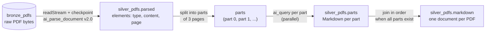
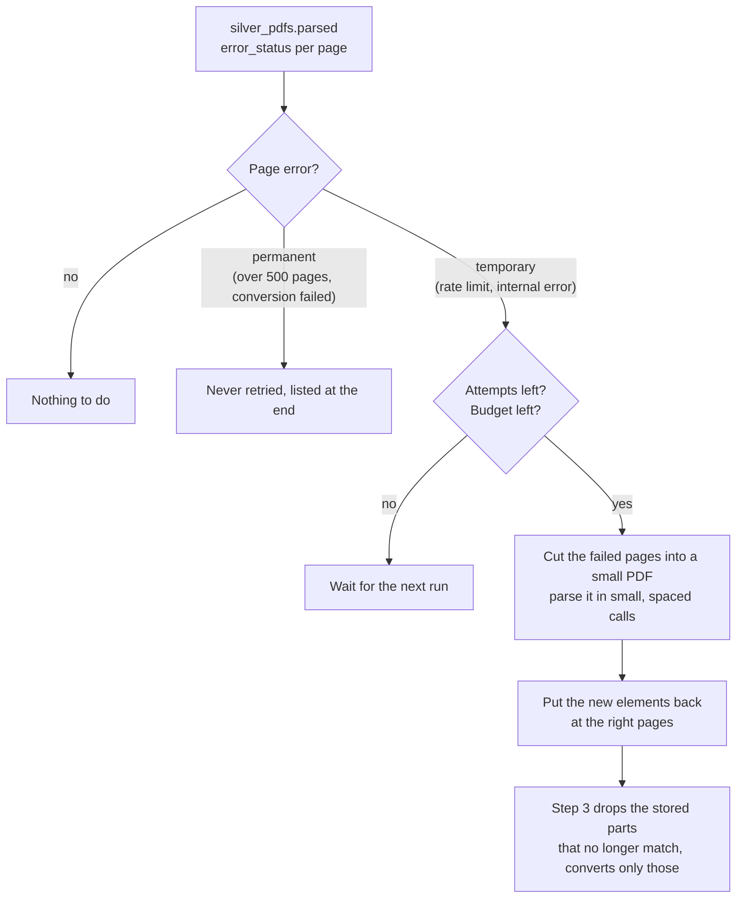

# Silver layer: from PDFs to Markdown

The silver layer turns each raw FinanceBench filing (a PDF of 100+ pages) into one clean **Markdown document**, with the document structure kept: titles, headings, plain text, tables, page headers and footers, and page separators. Gold (chunking and embeddings for RAG) builds on this text.

- **Task:** `silver_parser`, the third task of the `ingest_financebench` job, after `download` and `bronze_pdfs`.
- **Code:** [src/silver_pdfs.ipynb](../../../src/silver_pdfs.ipynb). Every stage there has its own explanation cell.
- **Output:** one Delta table, `silver_pdfs`, with one row per PDF.
- **Built with:** Databricks `ai_parse_document` (layout extraction), `ai_query` (conversion to Markdown), Structured Streaming and Delta `MERGE`.

## At a glance



| Stage | What happens | Why it is safe to rerun |
| --- | --- | --- |
| 1. Create the table | `CREATE TABLE IF NOT EXISTS` with explicit columns | `IF NOT EXISTS`; adds missing columns to an older table |
| 2. Parse | Streams `bronze_pdfs`, runs `ai_parse_document`, appends to `silver_pdfs` | The streaming checkpoint remembers parsed PDFs |
| 3. Convert | Splits each document into parts, runs `ai_query` per part, stores the parts, joins them into `markdown` | Only parts not yet stored are sent to the model |

## The table

One table, `silver_pdfs`:

| Column | Meaning |
| --- | --- |
| `path` | Volume path of the PDF |
| `parsed` | `ai_parse_document` output (VARIANT): every element with its type, content and page |
| `markdown` | The final Markdown document. NULL until every part is converted |
| `parts` | `MAP<INT, STRING>`: the Markdown of each converted part, by part number |
| `num_parts` | How many parts the document has |

`parts` and `num_parts` are what make step 3 resumable: they record what is already done.

## Example: input and output

`ai_parse_document` returns a list of typed elements. For the first page of the Boeing 2022 10-K:

| type | page | content |
| --- | --- | --- |
| figure | 0 | BOEING |
| text | 0 | UNITED STATES SECURITIES AND EXCHANGE COMMISSION Washington, D.C. 20549 |
| title | 0 | FORM 10-K |
| text | 0 | (Mark One) |
| ... | ... | ... |

After `ai_query`, the same page is Markdown, starting with the page marker, with the title as a heading:

```markdown
<!-- page 1 -->
*BOEING*
UNITED STATES
SECURITIES AND EXCHANGE COMMISSION
Washington, D.C. 20549

# FORM 10-K

(Mark One)
...
## THE BOEING COMPANY
(EXACT NAME OF REGISTRANT AS SPECIFIED IN ITS CHARTER)
```

A table in the filing (given by the parser as HTML) comes out as a Markdown table:

```markdown
| Union | Percent of our Employees Represented | Status of the Agreements with Major Union |
| --- | --- | --- |
| The International Association of Machinists and Aerospace Workers (IAM) | 20% | We have two major agreements; one expiring in September 2024 and one in July 2025. |
| The Society of Professional Engineering Employees in Aerospace (SPEEA) | 10% | We have two major agreements expiring in October 2026. |
```

Pages are separated by a blank line, `---`, a blank line and `<!-- page N -->`.

## How the conversion works

### Stage 2: parse (once per PDF)

`ai_parse_document(content, map('version', '2.0'))` extracts the layout of the whole PDF. It has no model to choose and is never split. The read is a stream with a checkpoint, so each PDF is parsed once, however often the job runs or is redeployed. `maxFilesPerTrigger` keeps each micro-batch small so progress is saved often.

### Stage 3: convert (once per part)

1. **Split.** The elements are numbered by page and grouped into parts of `pages_per_call` pages (default 3): pages 1-3 are part 0, pages 4-6 are part 1, and so on. A page is never cut in half.
2. **Convert.** Each part goes to `ai_query` with a prompt that keeps all content and asks for headings (`#`, `##`), plain text, Markdown tables, italic page headers/footers and page markers. `temperature` is 0. The calls run in parallel across the cluster.
3. **Store.** Successful parts are merged into `parts`. Failed parts are not stored.
4. **Validate.** The markers in each result must be exactly the part's page numbers. A part that fails is redone one page per call and stitched together in code. A page that still fails is not stored and is retried later.
5. **Join.** When a document has all `num_parts` parts, `markdown` is built from them in order, with `---` between parts (added in code, so it is exact).
6. **Repeat.** The cell works through the documents in batches of `docs_per_batch` (default 50), saving each batch before starting the next. One job run converts every document.

## Challenges and solutions

These are real problems hit while building and testing the layer.

| # | Challenge | Impact | Solution |
| --- | --- | --- | --- |
| 1 | The model endpoint caps output at **10000 tokens** | A whole filing in one call was cut off silently: a 150-page filing came back as about 43,000 characters | Split each document into parts of a few pages, one `ai_query` call each, then join |
| 2 | The page number is in `bbox[0].page_id`, not on the element | Every element had a NULL page, so each document became one page and one part, causing challenge 1 to reappear | Read the page from `bbox[0].page_id` (verified: 1,042 elements spread over 150 pages) |
| 3 | A failure late in a long run would lose everything | A rerun would pay again for thousands of `ai_query` calls | Store each successful part. A rerun sends only the missing parts. Save per batch of documents |
| 4 | A part that can never succeed would loop forever | Wasted money | The loop stops when a batch stores no new part |
| 5 | Parsing is slow and billed per document | Reparsing on every run | Streaming checkpoint: each PDF is parsed once |
| 6 | The configured model endpoint did not exist, and `ai_query` rejected `max_tokens` above the endpoint's cap | The job failed in step 3 | List the endpoints with `databricks serving-endpoints list`; use `databricks-qwen3-next-80b-a3b-instruct` with `max_tokens` 10000 |
| 7 | `ai_query` with `failOnError => false` returns `result` and `errorMessage` | Reading a field called `response` failed with `FIELD_NOT_FOUND` | Read `r.result` |
| 8 | The table already existed with fewer columns | `CREATE TABLE IF NOT EXISTS` does not add columns | `ALTER TABLE ... ADD COLUMNS` when `parts` is missing |
| 9 | Some PDFs cannot be parsed at all: `ai_parse_document` rejects PDFs over 500 pages (for example the PepsiCo 10-Ks) and sometimes fails a conversion | Such a document has no elements, so it never produces a part. In the first full run these were picked first in every batch, a batch stored nothing and the loop stopped with 189 convertible documents left | Step 3 only picks documents that have parsed elements, and lists the skipped ones with the parser's reason |
| 10 | Calls could run one after another if few partitions held the parts | Slow step 3 | `repartition(32)` spreads the calls over the workers |
| 11 | The model repeats or skips `<!-- page N -->` markers (151 of 359 documents had a different marker count than pages) | Page numbers in the Markdown cannot be trusted | Validate each part's markers, redo bad parts page by page with the marker added in code, stitch in code |
| 12 | `ai_parse_document` failed on some pages: `Request rate limit exceeded` (2,815 pages in 53 documents) and `Internal error` (365 pages in 11 documents). Found with the inspection notebook | About 6% of the pages (3,180 of 49,965 in the converted documents) have no content, so they are missing from the Markdown. PepsiCo 2018 lost 278 of 479 pages | Step 2b: validate the parse, re-parse only the failed pages within a page budget, reconvert only the parts that changed |

## Validating the parse and re-parsing failed pages (step 2b)

`ai_parse_document` sometimes answers a page with an error instead of content, mostly when many PDFs are parsed at once. In the first full run **3,180 of 49,965 pages (6%) failed**, in 55 documents. Those pages have no text, so they were missing from the Markdown. Step 2b finds them and parses only them again. It is built for a limited quota (the Databricks free tier): it spends as little as it can, and it never spends more than a budget you set.

**How it decides what to do**



| Guard | What it does | Why |
| --- | --- | --- |
| Validate first | Reads the parser's own `error_status`. Only temporary errors (rate limit, internal error) are retried. A PDF over 500 pages or a failed conversion is never retried | A retry that cannot work is wasted quota |
| Re-parse only the failed pages | Builds a small PDF from just those pages (PyMuPDF) and parses that | Re-parsing the 55 documents whole would bill about 14,000 pages. This bills 3,180 |
| Page budget per run | `reparse_page_budget`, default 300 pages | A large backlog is worked off over several runs, and one run can never spend more than the budget |
| Small, spaced calls | `reparse_chunk_pages` pages per call (default 20), `reparse_pause_seconds` between calls (default 10), one document at a time | The rate limit that caused the errors is not hit again |
| Stop on rate limit | If more than half of a call's pages fail again, the run stops | Do not keep spending while the service is limiting |
| Attempt cap | `parse_attempts` counts failed passes. After `reparse_max_attempts` (default 3) the document is left alone | A page that always fails cannot loop forever |
| Dry run | `reparse_dry_run = yes` prints the plan (documents, pages, what a whole re-parse would cost) and spends nothing | Look before spending |
| One document | `reparse_doc` limits the run to one document | A cheap test |
| Reconvert only what changed | After a re-parse, step 3 compares each stored part's page markers with the pages the new parse puts in that part, **without any `ai_query` call**, and drops only the parts that differ | Parts before the first changed page are kept. Only the changed parts are paid for again |
| Conversion budget | `max_parts_per_run`, default 1000 parts | The `ai_query` spend of one run is capped too |

**Why page numbering is not changed.** Pages are still counted 1, 2, 3 over pages that have content. Changing to true PDF page numbers would invalidate the stored parts of 48 other documents that have genuinely empty pages, and cost many extra `ai_query` calls.

**Running it safely**

1. Look: set `reparse_dry_run` to `yes` and run. It prints the plan and spends nothing.
2. Test: set `reparse_doc` to one document and `reparse_page_budget` to a small number.
3. Then run normally. Each run re-parses up to the budget and converts what changed. Repeat until the plan is empty.

The inspection notebook ([src/inspect_parsed.ipynb](../../../src/inspect_parsed.ipynb)) shows the parser errors of any document and which pages are missing.

## Verified results

Tested in the `dev` job on three filings. Every part completed and the Markdown ends at the end of the filing, with the signature block.

| Document | PDF pages | Pages with parsed content | Page markers | Parts | Markdown size |
| --- | --- | --- | --- | --- | --- |
| Lockheed Martin 2020 10-K | 132 | 112 | 112 | 38 / 38 | 465k characters |
| Boeing 2022 10-K | 190 | 115 | 115 | 39 / 39 | 335k |
| Corning 2015 10-K | 273 | 270 | 270 | 90 / 90 | 922k |

- One `<!-- page N -->` marker per page that had parsed content. The PDF page count is higher than the pages with content because `ai_parse_document` failed on some pages with `Request rate limit exceeded` or `Internal error` (found with the inspection notebook; see challenge 12). Those pages are missing from the Markdown.
- Headings and Markdown tables are present in all three.
- The three-document test took about 3 minutes in step 3 before the `repartition` change.

Not yet verified: accuracy of table cells against the PDF on a larger sample, and total time and cost for all 368 filings.

## Running it

```bash
databricks bundle deploy -t dev
databricks bundle run ingest_financebench -t dev
```

Parameters (notebook widgets):

| Widget | Default | Meaning |
| --- | --- | --- |
| `catalog`, `schema` | `workspace`, `finance_bench_rag` | From the bundle variables |
| `endpoint` | `databricks-qwen3-next-80b-a3b-instruct` | Model serving endpoint used by `ai_query` |
| `max_files_per_batch` | `10` | Step 2: bronze files per micro-batch |
| `pages_per_call` | `3` | Step 3: pages per `ai_query` call. Lower it if parts fail |
| `docs_per_batch` | `50` | Step 3: documents per save point |

Other operations:
- **Rerun or redeploy:** safe. Nothing already stored is parsed or converted again.
- **Redo only the prompt:** `UPDATE silver_pdfs SET markdown = NULL, parts = NULL, num_parts = NULL`, then rerun. The parse is kept.
- **Full rebuild:** drop `silver_pdfs`, delete the checkpoint folder `/Volumes/<catalog>/<schema>/docs/_checkpoints/silver_pdfs` and rerun. Dropping only the table leaves the checkpoint, so nothing would be reparsed.

## Limits and next steps

- **Cost:** `ai_parse_document` and `ai_query` are billed per use. A 150-page filing is about 50 `ai_query` calls, so the full set is on the order of 15,000 calls.
- **Inspecting documents:** [src/inspect_parsed.ipynb](../../../src/inspect_parsed.ipynb) shows the PDF page with the parsed element boxes, the parsed text next to the Markdown, and a marker check.
- **Model-written separators:** the `<!-- page N -->` markers inside a part are written by the model. Between parts they are added in code. A count check against the parsed pages is the way to verify them.
- **Unparseable PDFs:** 9 of 368 filings (7 over the 500-page limit, 2 failed conversions) have no parsed content and no `markdown`. Handling them needs the PDF split into smaller files before parsing.
- **Changed or deleted PDFs:** not handled. Bronze tracks files by path, and silver keeps rows of deleted files. See [happy_unhappy_path.md](happy_unhappy_path.md).
- **Failure reasons are not stored:** failed parts are counted in the log but their error messages are not saved.
- **Next layer:** gold chunks the Markdown (for example by heading or page) and creates embeddings for retrieval.
