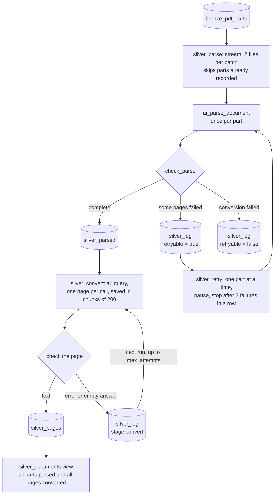
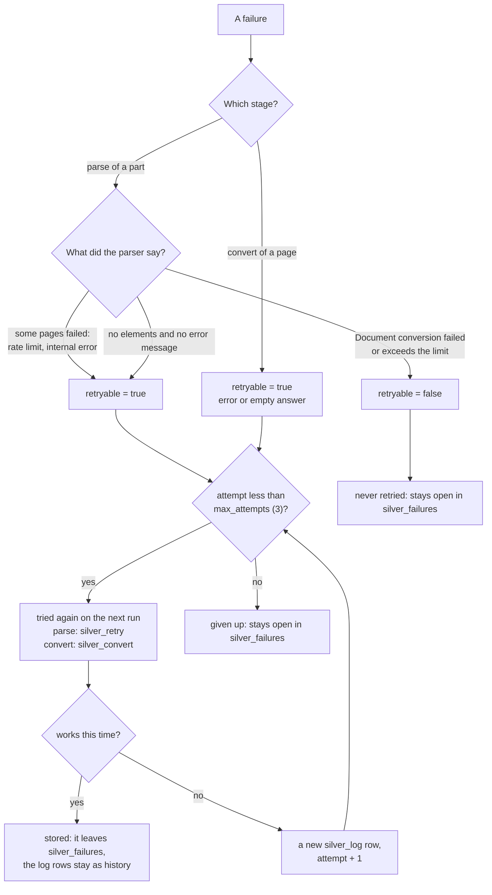

# Silver layer: operations

Silver has its own schema (`finance_bench_silver`, dev `finance_bench_silver_dev`). It reads the parts of the PDFs from bronze (`bronze_pdf_parts`, see [bronze.md](../bronze/bronze.md)), parses each part and converts each page. The tables below are in the silver schema.

The design, the stages and the challenges are in the [README](../../../README.md#3-silver-pdfs-to-markdown), and every stage is explained in its notebook in [src/silver/](../../../src/silver/). This page is for **running and looking after** the silver layer.

## Flow



## What is where

| Name | Kind | Holds |
| --- | --- | --- |
| `silver_parsed` | table | One row per part with a complete parse (`path`, `part_no`, `page_offset`, `parsed` VARIANT, `pdf_pages`, `pages`, `parsed_at`) |
| `silver_pages` | table | The Markdown of each converted page (`path`, `page_no`, `markdown`, `converted_at`) |
| `silver_log` | table | The trail of every failure (`path`, `stage` parse or convert, `page_no`, `attempt`, `retryable`, `reason`, `pdf_pages`, `logged_at`, `part_no`). A parse failure is about a part (`part_no`), a convert failure about a page (`page_no`) |
| `silver_documents` | view | The final Markdown per PDF, only when all its parts are parsed and all its pages are converted |
| `silver_failures` | view | What is still open: parts not parsed and pages not converted, with the last reason |

`page_no` is the real PDF page number (the part's `page_offset` plus the parser's page id plus 1), also for a PDF cut into parts. The `<!-- page N -->` markers in `silver_documents` use the same number.

## `silver_log`: retryable and not retryable

Every failure is a row in `silver_log`. Nothing is ever deleted from it. `silver_failures` shows only what is still open: a parse failure is closed when its part is stored in `silver_parsed`, and a page failure when its page is stored in `silver_pages`.

| Column | Meaning |
| --- | --- |
| `stage` | `parse` (a part) or `convert` (a page) |
| `part_no` / `page_no` | The part that failed to parse, or the page that failed to convert |
| `attempt` | 1 for the first failure, then 2, 3, ... Each failed try is a new row |
| `retryable` | Whether trying again can help |
| `reason` | The message from the parser or the model |



| | Retryable (`true`) | Not retryable (`false`) |
| --- | --- | --- |
| **Parse** | `N pages failed: Request rate limit exceeded` or `Internal error`: the service was busy, the part itself is fine. Also a part with no elements and no error message | `Document conversion failed`: the parser cannot read the file, so a retry gives the same answer. (`Document has N pages, which exceeds the limit of 500` was the other case: it cannot happen now, because parts have at most 50 pages) |
| **Convert** | Always: an error from `ai_query` or an empty answer is treated as temporary | Never |
| **Who retries it** | `silver_retry` takes parse failures that are retryable and have `attempt` below `max_attempts`, shortest parts first, with a pause, and stops after two failures in a row | Nobody. It stays in `silver_failures` for you to look at |
| | `silver_convert` takes pages with fewer than `max_attempts` failed rows | |
| **After `max_attempts`** | Left alone, still listed in `silver_failures`. Raise `max_attempts` for one run to try again | |

**The rule behind it.** A failure is retryable when the cause is outside the file (a busy service, a model hiccup). It is not retryable when the file itself is the cause, because trying again would only spend quota for the same result.

**Today on prod:** 2 open failures, both not retryable: `INTEL_2023_8K_dated-2023-02-10.pdf` and `INTEL_2023_8K_dated-2023-08-16.pdf` (`Document conversion failed`). Everything else is stored.

```sql
-- What failed, grouped by cause
SELECT stage, retryable, left(reason, 80) AS reason, count(*) AS rows FROM silver_log GROUP BY ALL ORDER BY rows DESC;

-- Still open, and whether a rerun can fix it
SELECT stage, retryable, count(*) FROM silver_failures GROUP BY stage, retryable;
```

## Where to look

```sql
-- How much is done
SELECT (SELECT count(*) FROM silver_parsed)    AS pdfs_parsed,
       (SELECT count(*) FROM silver_documents) AS documents_complete,
       (SELECT count(*) FROM silver_pages)     AS pages_converted;

-- What is still open, and why
SELECT stage, retryable, count(*) FROM silver_failures GROUP BY stage, retryable;
SELECT * FROM silver_failures ORDER BY stage, path;

-- The history of one PDF
SELECT * FROM silver_log WHERE path LIKE '%PEPSICO_2018%' ORDER BY logged_at;
```

## What to do when something is open

| In `silver_failures` | Meaning | What to do |
| --- | --- | --- |
| stage `parse`, retryable | Pages of a part failed (rate limit, internal error) | Run the job. The retry takes the part (at most `part_pages` pages). After `max_attempts` it is left alone: raise `max_attempts` for one run if you want another try |
| stage `parse`, not retryable | A failed conversion | A retry cannot help. Accept that it is missing, or try other `part_pages` |
| stage `convert` | A page returned an error or an empty answer | Run the job. The page is tried again, up to `max_attempts` |
| nothing, but a PDF is not in `silver_documents` | Pages are not converted yet (a run stopped early) | Run the job again |

## Running it with a small quota

There are no budgets: a run does everything that is missing. The load is limited by:

| Widget | Limits |
| --- | --- |
| `max_files_per_batch` | PDFs parsed at once by the stream (small = fewer rate-limit errors) |
| `max_attempts` | Tries per PDF or page before giving up |

Two failed retries in a row stop the retries, and a convert chunk that stores nothing stops the conversion. Run again later.

## Maintenance notes

- Every stage only does what is missing. Running the job twice in a row does nothing the second time.
- `silver_log` only grows. A failure is never deleted: it stops being listed in `silver_failures` when the PDF or page is finally stored.
- To redo the Markdown with a new prompt: `DELETE FROM silver_pages`, then run. The parses are kept.
- Full rebuild: drop the three tables and two views (or the whole silver schema), and run. The stream's checkpoint is in the silver schema (the volume `checkpoints`), so dropping the schema resets it too.
- **Tasks.** `silver_parse` (stream: parse and check), `silver_retry` (parse the retryable parts again) and `silver_convert` (one `ai_query` call per page). Each one creates the tables if they are missing, so each can be run alone.
- **One unit.** The job `financebench_pipeline` ([resources/financebench_pipeline_job.yml](../../../resources/financebench_pipeline_job.yml)) runs `ingest_financebench` and then `validate_silver`. Indexing will be added as a third task. Run it with `databricks bundle run financebench_pipeline -t <target>`.
- **Validation is a separate job.** `validate_silver` only reads the tables and fails if a rule that must hold is broken (a PDF with no record, duplicate or empty pages, pages beyond the document). Run it after the ingest job: `databricks bundle run validate_silver -t <target>`.
- **Where the logic lives.** Checks on parser and model output: `src/silver/checks.py` (plain Python, tested with `pytest`). Table and view definitions and the insert helper: `src/silver/silver_tables.py` and `src/common/names.py`. Cutting the PDFs is bronze (`src/bronze/splitting.py`). Parse and file a part: `src/silver/parsing.py`.
