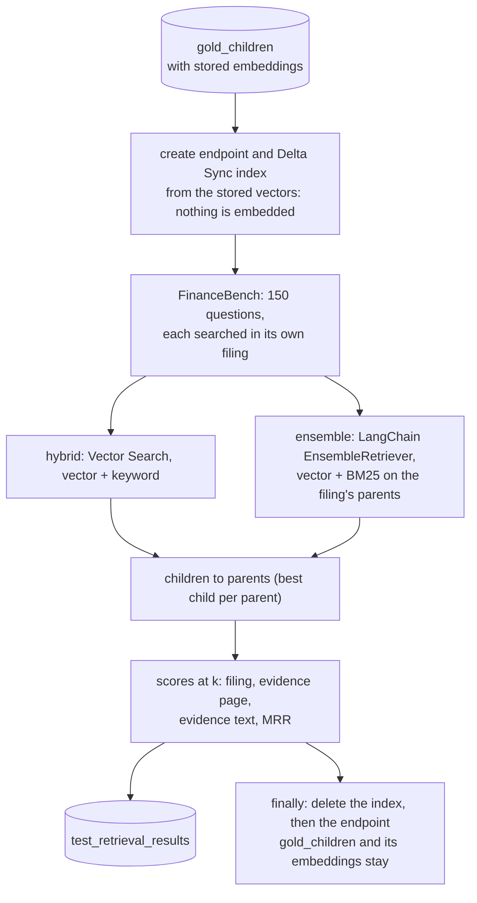

# Test retrieval

The job `test_retrieval` is **run by hand**. It is not in `financebench_pipeline`, because it creates a Vector
Search endpoint, which is billed by the hour while it exists.

```bash
databricks bundle run test_retrieval -t dev
```

Everything is in one notebook, [test_retrieval.ipynb](../../src/retrieval/test_retrieval.ipynb), one section per
step. There is not much to it, so it is not split into modules.

## Flow



The teardown is in a `finally` block, so it runs when the evaluation fails too. A cancelled run can leave the
endpoint up: run the job again with `teardown_only = true`, which only deletes. Teardown raises if the endpoint is
still there at the end, so a run never ends green with an endpoint left running.

## Retrieval

LangChain on the driver. For one typed question (a RAG app later) the retriever part needs no Spark.

| Part | How |
| --- | --- |
| Vector store | `DatabricksVectorSearch` on the index, questions embedded with the same model as the chunks (`DatabricksEmbeddings`) |
| Parent-child | `parent_search` (a function wrapped in a `RunnableLambda`, so it is a LangChain retriever): searches 4 × k children and keeps the best child per parent. It returns the parent's text (`parent_text`, synced into the index, not embedded). A fixed chunk is its own parent |
| `hybrid` | One Vector Search call that does vector and keyword search, on the Databricks side |
| `ensemble` | `EnsembleRetriever` of `parent_search` (vector only) and `BM25Retriever` on the filing's parents, merged by Reciprocal Rank Fusion, without duplicates (`id_key`) |
| Filters | Every search is limited to the question's `strategy` and filing (`path`). BM25 runs on the driver, so it is built per filing, on a few hundred texts, never on all of them |
| In parallel | `retriever.batch(..., max_concurrency=4)`: threads. The search itself runs on the Databricks endpoint |

## Scores

Each is the share of the questions, at k = 1, 3, 5 and 10:

| Score | A hit when |
| --- | --- |
| `doc_hit` | A chunk of the right filing is in the top k |
| `page_hit` (main) | A top-k chunk covers the evidence page (`page_start` ≤ page ≤ `page_end`) |
| `evidence_hit` | A top-k chunk has at least 70% of the words of the evidence text (the parser's text is not FinanceBench's) |
| `mrr` | 1 / rank of the first chunk that covers the evidence page, 0 if none in the top k |

FinanceBench's `evidence_page_num` is **0-based** (checked on the 3M 2018 10-K, where page 59 is the cash flow
statement at PDF index 59). Gold pages are 1-based, so 1 is added. A question whose filing has no chunks counts as a
miss. All 150 open-source questions have their evidence in their own filing, and none is about the two Intel 8-Ks
that cannot be parsed.

**On dev** only 14 questions are about earnings releases (6 filings), so dev checks that the job works. The numbers
that matter come from prod.

```sql
SELECT * FROM test_retrieval_results ORDER BY run_at DESC, k, page_hit DESC;
```

## Widgets

| Widget | Default | Meaning |
| --- | --- | --- |
| `strategies` | `structured,fixed` | Strategies to test |
| `modes` | `hybrid,ensemble` | Search modes to test |
| `ks` | `1,3,5,10` | Cut-offs of the scores |
| `vector_search_endpoint` | `financebench_vs` (dev `financebench_vs_dev`) | Created and deleted by the run |
| `embedding_endpoint`, `embedding_dimension` | `databricks-gte-large-en`, `1024` | Must match the `indexing` job |
| `teardown` | `true` | `false` keeps the endpoint for a demo (billed!) |
| `teardown_only` | `false` | `true` only deletes the index and the endpoint |

## Packages

Pinned in the notebook and checked together on Python 3.11: `databricks-vectorsearch==0.82`,
`databricks-langchain==0.23.0`, `langchain-classic==1.0.8` (LangChain 1.x moved `EnsembleRetriever` there),
`langchain-community==0.4.2` (`BM25Retriever`, being sunset by LangChain), `rank-bm25==0.2.2`, and `mcp==1.26.0`:
`mcp` 2.x breaks `import databricks_langchain` 0.23.0.

## Not checked yet

The notebook has not run on Databricks yet, and has no unit tests. On the first dev run, check:

- That Vector Search is available on the workspace, and what the endpoint costs per hour.
- That hybrid search works on an index with stored vectors (`DatabricksVectorSearch` embeds the question and sends
  the text too). Which column the keyword part matches on was not checked.
- That a filter on `path` works (the paths contain `/` and `&`).
